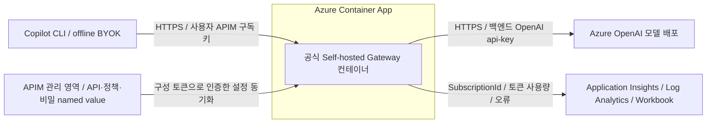
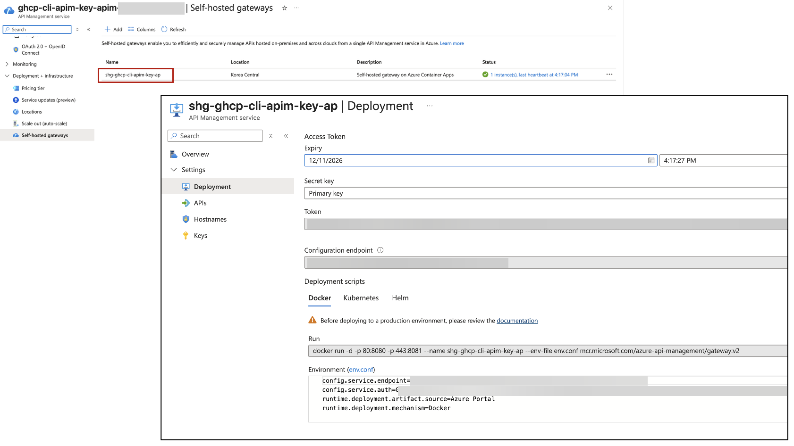
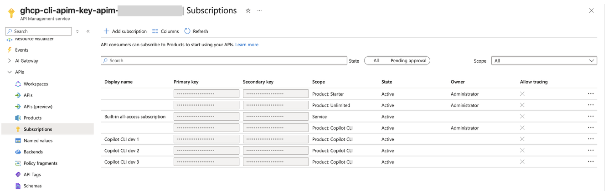
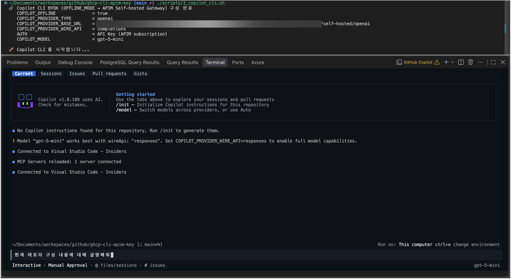
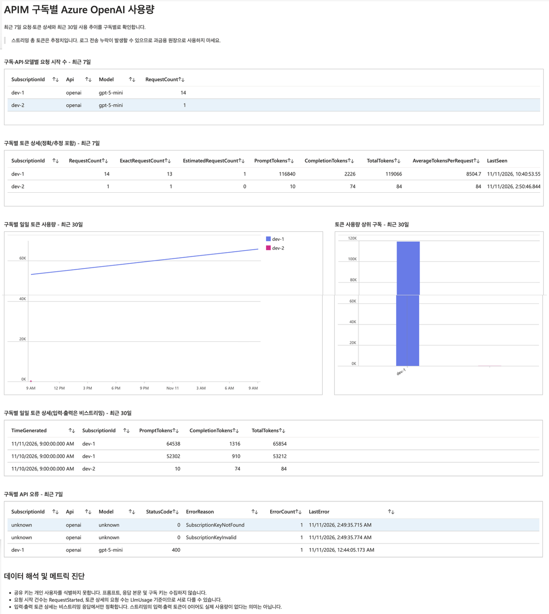
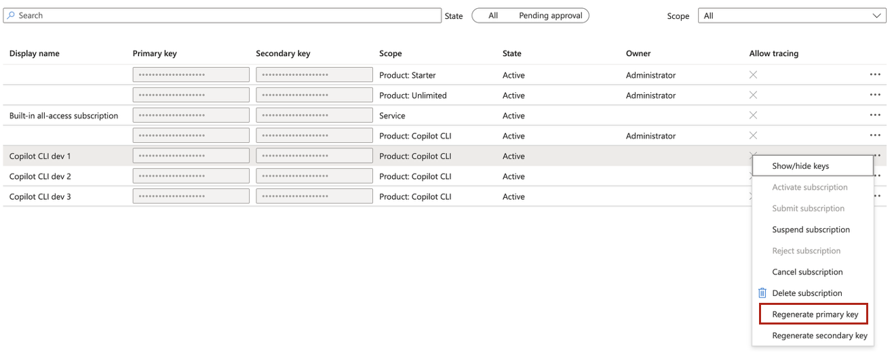
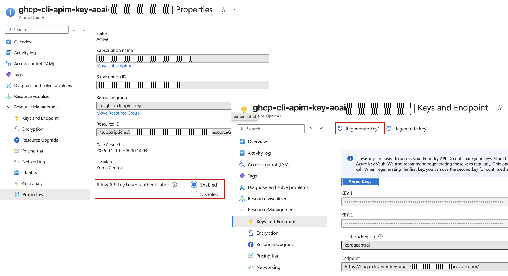

# 망분리 환경에서 APIM을 이용해서 Copilot CLI 실행하기

## 개요

망분리 환경에서 조직이 승인한 AI 서비스를 Copilot CLI에 연결하려는 운영자와 개발자를 위한 샘플입니다.
클라이언트가 Azure OpenAI를 직접 호출하는 대신 APIM Self-hosted Gateway를 거치도록 구성해,
모델 요청의 인증·토큰 한도·사용량 기록을 한곳에서 관리합니다.

Copilot CLI는 GitHub 로그인 없이 BYOK(Bring Your Own Key) offline 모드로 실행합니다.
개발자별로 발급한 APIM 구독 키로 Gateway를 호출하고, Gateway가 별도로 보관한 Azure OpenAI API 키로
모델에 접근합니다. Azure OpenAI 백엔드 키를 개발자에게 직접 배포하지 않습니다.

### 제공 기능

- Bicep과 스크립트를 이용한 APIM, Azure OpenAI, ACA Self-hosted Gateway 및 모니터링 리소스 구성
- 개발자별 APIM 구독 생성과 구독 키 기반 모델 호출 인증
- Gateway 정책을 통한 배포 모델 지정, 구독별 토큰 제한 및 사용량·오류 기록
- Copilot CLI 실행, 키 인증 검증 및 Workbook을 이용한 구독별 사용량 조회

### Disclaimer

> [!IMPORTANT]
> 이 아키텍처는 참고용이며, Private Network 환경을 고려해 설계되지 않았습니다.
> Copilot CLI에서 APIM Self-hosted Gateway를 통해 모델을 호출하는 부분만 참고하세요.
> 폐쇄망이나 망분리 통제는 자동으로 구성하지 않으며, 실제 적용 시 조직의 요구사항에 맞춰 별도로 설계해야 합니다.
> 기본 배포는 ACA 외부 HTTPS ingress와 공개 Azure endpoint를 사용합니다.
> BYOK offline 모드는 GitHub 로그인 없이 자체 모델을 사용하는 방식이지, 외부 통신이 없는 완전 오프라인 실행을 뜻하지 않습니다.

## 아키텍처



화살표는 요청·설정·로그의 데이터 흐름이며, ACA 상자는 Container App 배포 경계입니다.
설정 동기화는 Gateway가 APIM 구성 서비스에 접속해 설정을 내려받는 방식입니다.
모델 요청 경로는 `CLI → ACA Self-hosted Gateway → Azure OpenAI`입니다.

### 구성 요소의 역할

- APIM은 API·정책·Product·구독 및 백엔드 키를 관리합니다.
- Self-hosted Gateway는 동기화한 정책을 실행하고 Azure OpenAI를 직접 호출합니다. 모델 요청은 관리형 Gateway를 경유하지 않습니다.

이 샘플이 생성하는 API는 `self-hosted-openai`이며 별도 `openai` API는 생성하지 않습니다.
모델은 독립 Azure OpenAI 계정의 배포이며 Foundry 프로젝트 리소스는 생성하지 않습니다.

### 인증과 자격 증명

| 구분 | 인증 및 자격 증명 |
|---|---|
| 리소스 배포·조회 및 구독 키 조회 | Azure CLI의 `az login`, Azure Developer CLI의 `azd auth login` 세션과 Azure 관리 권한 |
| Copilot CLI → Self-hosted Gateway | `Ocp-Apim-Subscription-Key` 헤더의 APIM 구독 키 |
| Self-hosted Gateway → Azure OpenAI | APIM의 비밀 named value `openai-backend-key`에 저장한 Azure OpenAI API 키를 `api-key` 헤더로 전달 |
| Gateway → APIM 구성 서비스 | ACA의 `gateway-token` secret에 보관한 별도의 Gateway 연결 토큰으로 구성·정책 동기화 |

Gateway는 API의 `subscriptionRequired: true` 설정에 따라 APIM 기본 구독 키 검증을 수행합니다.
키가 없거나 잘못되면 `401`로 거절하며, 정책 XML에서 동일한 키 비교를 다시 구현하지 않습니다.
구독 키는 개인 로그인 인증이 아니므로 같은 키를 공유하면 사용량과 토큰 한도도 같은 구독으로 집계합니다.

Azure 리소스 관리 로그인은 모델 API 호출 인증과 별개입니다.
현재 CLI 실행 스크립트는 시작 시 Azure 관리 API에서 리소스 정보와 APIM 구독 키를 조회하므로,
`az login` 세션과 해당 관리 권한이 필요합니다.
모델 호출은 키 기반으로 인증하며, CLI → Gateway는 APIM 구독 키, Gateway → Azure OpenAI는 Azure OpenAI API 키를 사용합니다.

## 필수 조건

- 모델 액세스 및 할당량이 있는 Azure 구독과 선택 모델·APIM SKU가 지원되는 지역
- 리소스 그룹, APIM, Azure OpenAI 및 모니터링 리소스를 생성할 권한
- APIM/ACA/모델 조회 및 APIM `subscriptions/read`, `subscriptions/listSecrets/action` 권한
- Bicep 배포 주체의 Azure OpenAI `accounts/listKeys/action` 권한
- Workbook 조회를 위한 대상 Log Analytics 로그 데이터 조회 권한

CLI 실행 계정에도 위의 리소스 조회·구독 키 읽기 권한이 필요합니다.
일반 사용자에게 관리 API 권한을 부여하지 않으려면 승인된 키 배포·리소스 설정 전달 방식을 별도로 구현해야 합니다.

<details>
<summary>CLI 및 실행 환경</summary>

Bash 3.2 이상과 다음 CLI들을 준비하세요.
사용 스크립트에는 [common.sh](scripts/common.sh)의 공통 함수를 통한 호출도 포함합니다.

| 도구·명령어 | 필요한 기능과 용도 | 사용 스크립트 |
|---|---|---|
| Azure Developer CLI (`azd`) | 로그인 완료, `azd env set --file` 지원, 환경값 조회 및 Bicep 인프라 배포 | [0_azd_up.sh](scripts/0_azd_up.sh), [1_create_self_hosted_gateway.sh](scripts/1_create_self_hosted_gateway.sh), [2_create_subscription_key.sh](scripts/2_create_subscription_key.sh), [3_copilot_cli.sh](scripts/3_copilot_cli.sh) |
| Azure CLI (`az`) | 로그인 완료, `az containerapp` 명령 지원, Azure 리소스·Gateway·APIM 구독 관리 및 키 조회 | [1_create_self_hosted_gateway.sh](scripts/1_create_self_hosted_gateway.sh), [2_create_subscription_key.sh](scripts/2_create_subscription_key.sh), [3_copilot_cli.sh](scripts/3_copilot_cli.sh) |
| GitHub Copilot CLI (`copilot`) | `COPILOT_PROVIDER_HEADERS` 지원 확인 및 BYOK offline 실행 | [3_copilot_cli.sh](scripts/3_copilot_cli.sh) |
| Node.js (`node`) | 입력 검증, JSON 처리, UUID 생성 및 모델 응답 검증 | [1_create_self_hosted_gateway.sh](scripts/1_create_self_hosted_gateway.sh), [2_create_subscription_key.sh](scripts/2_create_subscription_key.sh), [3_copilot_cli.sh](scripts/3_copilot_cli.sh)의 `--verify-only` |
| `curl` | Gateway 상태 확인 및 구독 키 인증 HTTP 검증 | [1_create_self_hosted_gateway.sh](scripts/1_create_self_hosted_gateway.sh), [3_copilot_cli.sh](scripts/3_copilot_cli.sh)의 `--verify-only` |

`azd`는 0단계에서 필수이며, 1·2·3단계에서는 필요한 환경변수가 없을 때 azd 환경값 조회에 사용합니다.
3단계의 일반 CLI 실행은 `node`와 `curl`을 직접 호출하지 않지만,
`--verify-only`에서는 둘 다 필요합니다. 이 검증 모드도 CLI 설정 지원 여부를 확인하므로 `copilot`이 필요합니다.

기본 OS 명령인 `env`, `dirname`, `date`, `mktemp`, `rm`, `rmdir`, `sleep`도 사용합니다.
Bicep은 `azd up` 배포 과정에서 사용하며, 스크립트가 별도 `bicep` 명령을 직접 호출하지는 않습니다.
Gateway 컨테이너는 ACA에서 실행하므로 로컬 Docker CLI는 필요하지 않습니다.

</details>

<details>
<summary>APIM SKU와 네트워크</summary>

이 아키텍처는 classic `Developer`와 `Premium`만 허용합니다.
두 계층은 VNet 주입과 self-hosted gateway를 지원하지만, `PremiumV2`는 classic `Premium`과 다릅니다.

| SKU | 용도 | VNet Injection | Self-hosted gateway |
|---|---|---|---|
| `Developer` | 개발 및 테스트 | 지원 | 지원 |
| `Premium` | 프로덕션 | 지원 | 지원 |

> [!IMPORTANT]
> SKU 지원과 실제 네트워크 구성은 다릅니다. [APIM 모듈](infra/modules/apim.bicep)은
> `publicNetworkAccess: 'Enabled'`, `virtualNetworkType: 'None'`을 사용합니다.
> [Azure OpenAI 모듈](infra/modules/openai.bicep)도 공개 접근을 허용하며, ACA는 HTTPS 외부 ingress로 배포합니다.
> VNet, 서브넷, Private Endpoint 및 프라이빗 DNS는 생성하지 않습니다.

</details>

### 망분리 환경에 적용할 때

운영 적용 전에는 조직의 보안 정책에 맞춰 다음 항목을 별도로 설계하고 승인받아야 합니다.

- Self-hosted Gateway 배포 방식: 이 샘플의 자동화는 ACA용이며 VM·Kubernetes 배포는 별도 구성
- 기업망에서 Gateway까지의 접근 경로와 필요한 사설 연결, 방화벽·프록시·DNS 설정
- Gateway의 APIM 설정 동기화, Azure OpenAI 모델 호출 및 모니터링 전송에 필요한 통신 경로
- 배포·관리 권한과 일반 사용자 권한의 분리, APIM 구독 키의 승인된 배포·회수 절차
- CLI 도구·플러그인·MCP 서버 및 실행 명령의 추가 통신에 대한 별도 통제

> [!IMPORTANT]
> CLI 실행에는 Gateway뿐 아니라 Azure 관리 API 접근도 필요합니다.
> 이 저장소의 설정만으로 망분리 준수 또는 외부 통신 차단을 보장하지 않습니다.

## 배포 및 실행 순서

### 0. 설정과 APIM·모델 배포

먼저 대상 환경에서 OpenAI API 키 인증을 허용하는지 확인하세요.
조직 정책이 로컬 인증을 금지하면 `disableLocalAuth: false`를 사용하는 배포 또는 백엔드 키 조회가 실패할 수 있습니다.
[Azure OpenAI 모듈](infra/modules/openai.bicep)에는 `SecurityControl=Ignore` 태그도 포함되어 있으므로
조직의 정책·승인 요구사항을 확인한 뒤 배포하세요. 이 태그 자체가 정책 예외 승인을 보장하지는 않습니다.

`az login`과 `azd auth login`은 대상 테넌트에 이미 완료되어 있다고 가정합니다.
[설정 예제](.env.example)를 복사한 뒤 구독, 테넌트, 지역, 게시자 및 모델 설정을 편집하세요.
키 값은 넣지 않습니다.

```bash
cp .env.example .env
# .env 값을 편집합니다. 기존 환경에서는 복사로 덮어쓰지 마세요.
azd env new dev  # 최초 한 번만 실행합니다.
./scripts/0_azd_up.sh
```

[0_azd_up.sh](scripts/0_azd_up.sh)는 저장소 루트의 `.env`를
`azd env set --file .env`로 가져온 뒤 `azd up`을 실행합니다.
동명 설정은 덮어쓰지만 파일에 없는 기존 azd 환경값은 유지합니다.
`--environment dev` 또는 `-e dev`를 전달하면 설정도 해당 환경에 가져옵니다.

[main.bicep](infra/main.bicep)과 [매개변수 파일](infra/main.parameters.json)은 다음을 구성합니다.

- 작업 영역 기반 Application Insights, Log Analytics, 사용량 Workbook 및 APIM 서비스의 GatewayLogs 진단 설정
- API 키 인증을 활성화한 Azure OpenAI 계정 및 모델 배포
- APIM 서비스 및 비밀 named value `openai-backend-key`(Azure OpenAI primary key 저장)
- 구독 필수 `self-hosted-openai` API와 `POST /self-hosted/openai/chat/completions` 통합 정책
- 구독 필수 Product `copilot-cli`(API를 묶는 단위)와 API 연결

Bicep은 클라이언트용 subscription이나 키를 생성하지 않습니다.
`APIM_SUBSCRIPTION_ID`는 CLI에서 사용할 APIM 구독 식별자이며,
[.env.example](.env.example)의 설정값은 `dev-1`입니다.
Product ID `copilot-cli`와는 별개이며, Azure 구독 ID나 인증 키 자체도 아닙니다.
`dev-1`로 지정하면 해당 구독의 키로 호출하고 사용량과 토큰 한도도 `dev-1` 기준으로 관리합니다.
환경값이 없을 때 인프라 매개변수의 기본값은 `copilot-cli`이지만, CLI 실행에는 `APIM_SUBSCRIPTION_ID` 설정이 필요합니다.
배포 출력에도 이 식별자만 포함되며, 해당 subscription이 생성되었음을 의미하지는 않습니다.
새 환경에서는 2단계 스크립트로 subscription을 생성한 뒤 CLI를 실행하세요.
키 값은 배포 출력에 포함하지 않습니다.
설정 예제의 모델은 `gpt-5-mini`, 버전 `2025-08-07`입니다.
모델 배포는 `OnceCurrentVersionExpired` 자동 버전 업그레이드를 허용하므로 실제 버전은 이후 달라질 수 있습니다.
지역별 모델 가용성 및 TPM 할당량에 맞춰 [.env.example](.env.example)의 모델·용량 값을 조정하세요.
배포 출력은 선택한 azd 환경에 저장됩니다.


#### 환경 설정 로드 규칙

1·2·3단계의 [공통 모듈](scripts/common.sh)은 다음 순서로 값을 읽습니다.

- `AZURE_ENV_NAME`이 없으면 루트 `.env`를 로드하며, 같은 이름의 기존 환경변수도 덮어씁니다.
- `AZURE_ENV_NAME`이 있으면 루트 `.env`를 읽지 않고 프로세스 환경변수를 사용합니다.
- 필수 설정이 비어 있을 때만 `azd env get-value`로 조회하며, azd 환경 전체를 일괄로 불러오지는 않습니다.

### 1. ACA self-hosted gateway 구성

```bash
./scripts/1_create_self_hosted_gateway.sh
```

[1_create_self_hosted_gateway.sh](scripts/1_create_self_hosted_gateway.sh)는 실제 APIM의
리소스 그룹과 지역을 조회하고 다음을 구성합니다.
`Microsoft.App` 리소스 공급자와 필요한 관리 권한은 미리 준비하세요.

- Bicep이 배포한 `self-hosted-openai` API와 백엔드 키 named value 존재 확인
- Self-hosted gateway 등록과 기존 API의 gateway 연결
- ACA 환경과 HTTPS 외부 ingress의 Container App
- 신규 환경과 앱의 `Consumption` profile 구성
- 공식 `mcr.microsoft.com/azure-api-management/gateway:v2` 이미지
- Gateway 연결 토큰의 ACA secret 저장 및 `secretRef` 참조
- 1 vCPU, 2 GiB 메모리, 최소·최대 replica 1개와 readiness probe

API·operation·Product 연결·정책·진단은 Bicep에서 관리합니다.
이 스크립트는 Gateway 등록·API 연결과 ACA 앱 설정을 갱신하며, API 정책이나 백엔드 키를 갱신하지 않습니다.

스크립트는 Gateway 상태와 구독 키 없는 요청의 거절 여부를 확인합니다. 모델 호출 검증은 3단계에서 합니다.
같은 이름으로 재실행하면 환경을 재사용하고 앱과 연결 토큰을 갱신·재시작합니다.
이름과 이미지는 [.env.example](.env.example)의 `SELF_HOSTED_GATEWAY_*`로 지정할 수 있습니다.



> [!IMPORTANT]
> Gateway 연결 토큰의 만료·갱신 주기와 절차는 [키 교체 주기와 방법](#키-교체-주기와-방법)을 참고하세요.
> APIM 구독 키와는 별개의 자격 증명입니다.

ACA 환경의 기본 로그 저장은 비활성화하며 기존 환경의 로그 설정은 변경하지 않습니다.
기존 ACA 환경은 Consumption 실행을 지원해야 합니다.
최소 replica 1개를 유지하므로 사용하지 않아도 비용이 발생할 수 있으며, 기존 Dedicated profile 비용도 별도로 확인하세요.
APIM 사용량은 기존 Application Insights에 기록됩니다.
ACA 및 gateway 요금과, Bicep 밖에서 생성한 후속 리소스의 정리 수명 주기를 별도로 관리하세요.

#### 운영 시 주의사항

- APIM 정책·비밀 named value 편집 권한과 Gateway 호스트 접근 권한은 백엔드 자격 증명에
  영향을 주므로 최소 권한으로 제한하세요. `secret: true`는 신뢰할 수 없는 운영자로부터 키를 격리하지 않습니다.
- Azure OpenAI 키를 CLI나 ACA 사용자 환경변수에 넣지 않습니다. 키 값은 승인된 비밀 관리 경로로만 취급하세요.

### 2. 개발자별 subscription과 키 생성

[2_create_subscription_key.sh](scripts/2_create_subscription_key.sh)로 개발자별 APIM 구독을 생성합니다.
선택한 Product 범위의 활성 subscription이 이미 있으면 이 단계를 건너뛸 수 있습니다.
호출 형식은 `[개수] [ID 접두사] [표시 이름]`입니다. 개수를 생략하면 1개를 생성합니다.
개수는 양의 정수여야 하며 ID 접두사를 생략하면 UUID 기반 고유 접두사를 자동 생성합니다.
아래 명령은 각각 독립된 예시이며, 연속해서 실행하는 순서가 아닙니다.

```bash
./scripts/2_create_subscription_key.sh 1 dev-1           # 설정 예제의 ID로 1개 생성
./scripts/2_create_subscription_key.sh                   # 고유 ID로 1개 생성
./scripts/2_create_subscription_key.sh 3                 # 고유 접두사로 3개 생성
./scripts/2_create_subscription_key.sh 3 dev "Developer" # dev-1, dev-2, dev-3 생성
./scripts/2_create_subscription_key.sh 1 dev-04 "Developer 04"
```

1개일 때는 지정한 ID를 그대로 사용하고, 여러 개일 때는 `-1`, `-2` 등 일련번호를 붙입니다.
표시 이름도 여러 개일 때는 `Developer 1`, `Developer 2` 등으로 구분합니다.
각 subscription은 별도의 primary/secondary 키 쌍을 가지므로 3개 요청 시 키 쌍 3개가 생성됩니다.

`.env` 또는 현재 azd 환경의 `AZURE_SUBSCRIPTION_ID`, `APIM_NAME`을 사용합니다.
APIM 조회 및 Product·subscription 읽기와 subscription 쓰기 권한이 필요합니다.
기존 `copilot-cli` Product 범위의 활성 subscription을 생성하며 primary/secondary 키는 APIM이 생성합니다.
키를 조회하거나 파일·로그에 출력하지 않고 생성된 ID와 Product 및 활성 상태를 확인합니다.



- 기존 구독 ID가 확인되면 생성 없이 중단합니다. 같은 ID를 동시에 생성하지 마세요.
- 중간 실패 시 이미 생성된 구독은 유지됩니다. 재시도 전에 APIM에서 생성 여부를 확인하세요.

이 스크립트는 소유자를 지정하지 않으므로 Developer Portal에서 개인별로 관리하려면
해당 APIM 사용자 계정을 소유자로 별도 연결해야 합니다.

이 스크립트로 생성한 subscription은 Bicep 관리 대상이 아니므로 중지·회수·정리도 별도 관리합니다.
이 스크립트는 `.env`나 azd의 기본 subscription ID를 변경하지 않습니다.

### 3. 키 인증 검증 및 Copilot CLI 실행

Gateway에 새 구독 설정이 동기화될 때까지 기다린 뒤, 설정된 구독으로 검증하고 CLI를 실행합니다.
대화형 실행과 `-p` 질문 실행은 필요에 따라 선택하세요.

```bash
./scripts/3_copilot_cli.sh --verify-only
./scripts/3_copilot_cli.sh
./scripts/3_copilot_cli.sh -p "승인된 검증용 질문"
```

다른 구독을 임시로 선택하려면 실제 azd 환경 이름과 구독 ID를 함께 지정하세요.
아래는 azd 환경이 `dev`이고 생성한 구독이 `dev-04`인 경우의 예시입니다.

```bash
AZURE_ENV_NAME=dev APIM_SUBSCRIPTION_ID=dev-04 ./scripts/3_copilot_cli.sh --verify-only
```

`AZURE_ENV_NAME`을 지정하면 루트 `.env`를 읽지 않으므로, 필요한 `SELF_HOSTED_GATEWAY_*` 등
선택 설정도 프로세스 환경변수로 함께 전달해야 합니다. 이 명령은 저장된 기본 구독 ID를 변경하지 않습니다.

[3_copilot_cli.sh](scripts/3_copilot_cli.sh)는 `.env` 또는 현재 azd 환경에서
`AZURE_SUBSCRIPTION_ID`, `APIM_SUBSCRIPTION_ID`, `APIM_NAME`,
`OPENAI_ACCOUNT_NAME`, `OPENAI_DEPLOYMENT_NAME`을 읽습니다.
Gateway와 모델 배포 정보를 조회하고 API 연결을 확인합니다.
확인에 실패하면 관리형 APIM이나 Azure OpenAI 직접 연결로 우회하지 않습니다.

선택한 활성 APIM 구독의 primary key를 자동 조회해 프로세스 메모리에만 보관합니다.
키를 파일, azd 환경, 설정 로그 또는 명령 인수에 넣지 않습니다.

<details>
<summary>환경변수</summary>

| 환경변수 | APIM 실행 값 |
|---|---|
| `COPILOT_OFFLINE` | `true` |
| `COPILOT_PROVIDER_TYPE` | `openai` |
| `COPILOT_PROVIDER_BASE_URL` | `https://<ACA-FQDN>/self-hosted/openai` |
| `COPILOT_PROVIDER_WIRE_API` | `completions` |
| `COPILOT_PROVIDER_API_KEY` | APIM subscription primary key, 출력하지 않음 |
| `COPILOT_PROVIDER_HEADERS` | `Ocp-Apim-Subscription-Key: <동일한 키>`, 출력하지 않음 |
| `COPILOT_MODEL`, `COPILOT_PROVIDER_MODEL_ID` | 배포 모델의 실제 이름 |
| `COPILOT_PROVIDER_WIRE_MODEL` | `OPENAI_DEPLOYMENT_NAME` |
| `COPILOT_PROVIDER_MAX_PROMPT_TOKENS` | 기본 `32768` |
| `COPILOT_PROVIDER_MAX_OUTPUT_TOKENS` | 기본 `4096` |

</details>

- **기본 실행**: 인수가 없으면 대화형, `--stream` 생략 시 `--stream off`.
- **`--verify-only`**: CLI 대화 없이 구독 키 인증과 모델 응답을 확인합니다.
  - Copilot 실행 인수와 함께 사용 불가. `--verbose`는 함께 사용 가능.
  - 유효 키 검사는 모델을 호출하므로 토큰 비용 발생.



## APIM 정책

[API 정책](apim/policies/openai-policy.xml)은 `self-hosted-openai` API에 배포되며,
구성을 동기화한 Self-hosted Gateway에서 다음을 수행합니다.

| 구분 | 구성 내용 |
|---|---|
| 호출 경로 제한 | 유효한 구독 키로 관리형 Gateway를 호출해도 정책에서 `403`으로 차단 |
| 클라이언트 인증 정보 제거 | 모델로 전달하기 전에 APIM 구독 키 헤더·쿼리와 `Authorization` 헤더 제거 |
| 모델·요청 변환 | 요청의 `model`을 지정한 배포명으로 고정하고, `max_tokens`를 `max_completion_tokens`로 변환하되 기존 `max_completion_tokens` 값은 유지 |
| 백엔드 인증 | 비밀 named value `openai-backend-key`의 Azure OpenAI 키를 `api-key` 헤더에 설정해 모델을 직접 호출 |
| 구독별 토큰 제한 | `llm-token-limit`으로 검증된 구독 ID 기준 분당 토큰 한도와 기간별 토큰 할당량 적용 |
| 토큰 메트릭 | `llm-emit-token-metric`으로 구독·API·모델별 네이티브 메트릭 발행 설정 |
| 요청·사용량·오류 기록 | `RequestStarted`에 구독 키 검증·토큰 제한을 통과한 요청 시작, `LlmUsage`에 응답 상태·토큰 사용량, `ApiError`에 정책 실행 오류 기록 |

모델과 토큰 한도는 Bicep 배포 시 정책에 반영됩니다.
`TOKENS_PER_MINUTE`, `TOKEN_QUOTA`, `TOKEN_QUOTA_PERIOD` 등을 변경하면 0단계를 재실행해야 합니다.
[진단 설정](infra/modules/apim.bicep)은 샘플링 100%, 오류 기록 활성화이며 요청·응답 본문과 인증 헤더를 수집하지 않습니다.

## 구독별 사용량과 키 운영

APIM 정책의 로그를 Application Insights를 통해 Log Analytics에 수집하도록 구성되어 있습니다.
[Workbook](infra/modules/workbook.bicep)은 `AppTraces`를 `SubscriptionId`별로 집계해
요청 수, 입력·출력·총 토큰, 일별 추이와 오류를 보여 줍니다. 배포 후 Workbook에서 실제 데이터 유입을 확인하세요.
요청 시작 수와 사용량의 요청 수는 서로 다른 이벤트 기준이며, 정책 실행 전 거절된 요청은 이 집계에 포함되지 않을 수 있습니다.



같은 키를 공유하면 사용량·한도도 공유하므로 사용자별 구독을 분리하세요.
비스트리밍 토큰 상세는 모델 응답의 `usage`가 있을 때 기록하며, 스트리밍은 추정 총 토큰을 기록합니다.
스트리밍의 입력·출력 토큰 0은 실제 미사용을 뜻하지 않습니다. 로그 전송 지연·누락도 가능하므로 과금 원장으로 사용하지 마세요.

### 키 교체 주기와 방법

> [!CAUTION]
> **Gateway 연결 토큰은 발급 후 29일에 만료되므로 20~25일마다 갱신하세요. 자동 갱신은 없습니다.**
>
> **APIM 구독 키와 Azure OpenAI 키는 이 샘플에 자동 만료·회전이 설정되어 있지 않습니다.
> 조직의 보안 정책에 따라 정기 교체하고, 유출이 의심되면 주기와 관계없이 즉시 교체하세요.**

#### Gateway 연결 토큰 갱신

이 토큰은 개발자가 모델 호출에 사용하는 APIM 구독 키가 아닙니다.
Self-hosted Gateway가 APIM 본체의 구성 endpoint에 인증하고 API·정책 설정을 동기화하기 위한 자격 증명입니다.

VM에서 Gateway 컨테이너를 실행해도 APIM 구성 서비스에 대한 인증은 필요하며,
동일한 연결 토큰 방식을 사용하면 만료 전 갱신도 필요합니다.
이는 이미지가 주기적인 키 교체를 강제해서가 아니라, **APIM이 검증하는 연결 토큰에 만료 시각이 있기 때문**입니다.
29일은 이 샘플의 발급 설정이며, 20~25일은 만료 전 여유를 둔 권장 갱신 간격입니다.
다른 인증 방식을 사용하면 해당 방식의 자격 증명 관리 절차를 따릅니다.

[1_create_self_hosted_gateway.sh](scripts/1_create_self_hosted_gateway.sh)를 재실행합니다.
새 토큰을 발급해 ACA의 `gateway-token` secret을 교체하고 Gateway 앱을 업데이트·재시작합니다.
현재 단일 replica 구성에서는 재시작 중 일시적으로 요청이 실패할 수 있으므로 작업 시간을 확보하세요.

```bash
./scripts/1_create_self_hosted_gateway.sh
```

위 스크립트는 ACA용입니다. VM에서는 새 토큰을 컨테이너 설정에 반영해 재생성·재배포해야 하며,
VM이나 기존 컨테이너를 단순 재시작하는 것만으로 토큰이 갱신되지는 않습니다.

이 작업은 Gateway의 Primary key 자체를 재생성하지 않으며, 이전 토큰도 만료 전까지 유효합니다.
토큰이 노출된 경우에는 APIM의 해당 Gateway에서 토큰 발급에 사용한 Primary key를 먼저 재생성한 뒤
위 스크립트를 실행하세요. 이 경우 기존 토큰이 무효화되므로 서비스 영향에 주의하세요.

#### APIM 구독 키 교체

현재 CLI는 선택한 구독의 primary key만 조회하므로 작업 시간을 확보하고 다음 순서로 교체합니다.

1. 해당 구독 키를 사용하는 CLI 세션을 종료합니다.
2. Azure Portal의 APIM → Subscriptions에서 대상 구독(예: `dev-1`)의 Primary key를 재생성합니다.
3. Self-hosted Gateway에 새 구독 설정이 동기화될 때까지 기다립니다.
4. 아래 공통 검증을 통과한 뒤 CLI를 다시 실행합니다. 실행 스크립트가 새 primary key를 자동 조회합니다.



구독 생성 스크립트는 키 회전용이 아닙니다.
Secondary key를 이용한 무중단 전환은 현재 CLI 스크립트에서 지원하지 않습니다.

#### Azure OpenAI 백엔드 키 교체

현재 Bicep은 Azure OpenAI의 KEY 1을 APIM의 비밀 named value `openai-backend-key`에 저장합니다.
자동으로 KEY 2로 전환하는 기능은 없으므로, 현재 스크립트 기준으로는 작업 시간을 확보하고 교체합니다.

1. 해당 KEY 1의 모든 사용처와 영향을 확인하고 모델 요청을 중단합니다.
2. Azure Portal에서 Azure OpenAI 리소스의 KEY 1을 재생성합니다. 이전 KEY 1은 사용할 수 없게 됩니다.
3. `./scripts/0_azd_up.sh`를 실행합니다. Bicep이 새 KEY 1을 조회해 named value에 반영합니다.
   이 명령은 전체 Bicep 인프라를 재배포하므로 다른 구성에 미치는 영향도 확인하세요.
4. Gateway 설정 동기화와 아래 공통 검증을 완료한 뒤 모델 요청을 재개합니다.



무중단 교체가 필요하면 KEY 2로의 전환·검증 절차를 별도로 설계해야 합니다.
키 값은 소스·로그·명령 인수에 넣지 말고 승인된 비밀 관리 경로로만 취급하세요.

#### 교체 후 공통 검증

대상 구독을 설정한 `.env` 또는 선택한 azd 환경을 사용해 검증합니다.
Gateway의 설정 동기화를 기다린 뒤 인증 검증이 성공하면 CLI를 다시 실행하세요.

```bash
./scripts/3_copilot_cli.sh --verify-only
./scripts/3_copilot_cli.sh
```

검증은 구독 키 인증과 모델 응답을 확인하며 토큰 비용이 발생합니다.

## 참고

- [APIM subscriptions](https://github.com/MicrosoftDocs/azure-docs/blob/main/articles/api-management/api-management-subscriptions.md)
- [Self-hosted gateway ACA 배포](https://github.com/MicrosoftDocs/azure-docs/blob/main/articles/api-management/how-to-deploy-self-hosted-gateway-container-apps.md)
- [APIM 비밀 named value와 정책 참조](https://learn.microsoft.com/en-us/azure/api-management/api-management-howto-properties)
