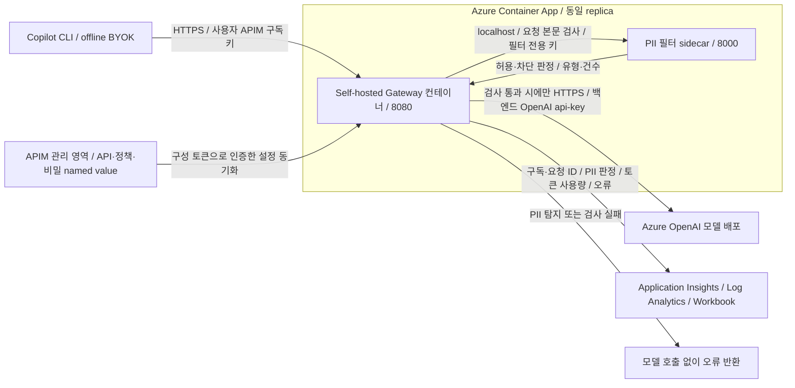
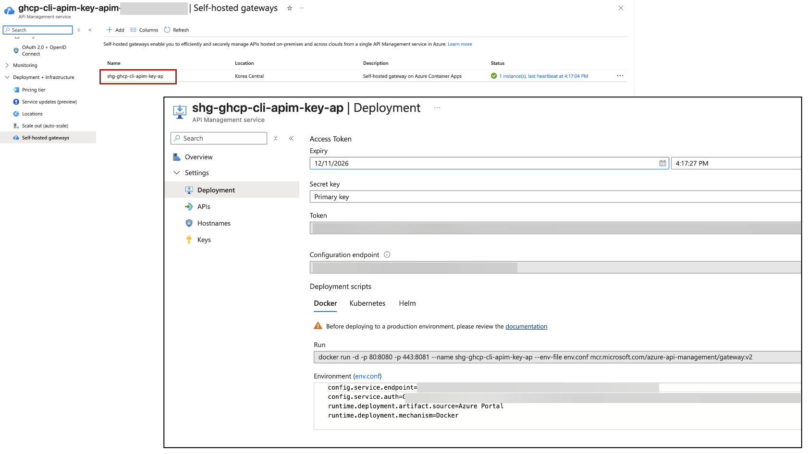
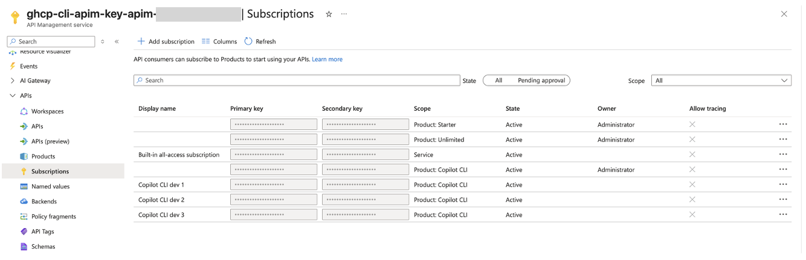
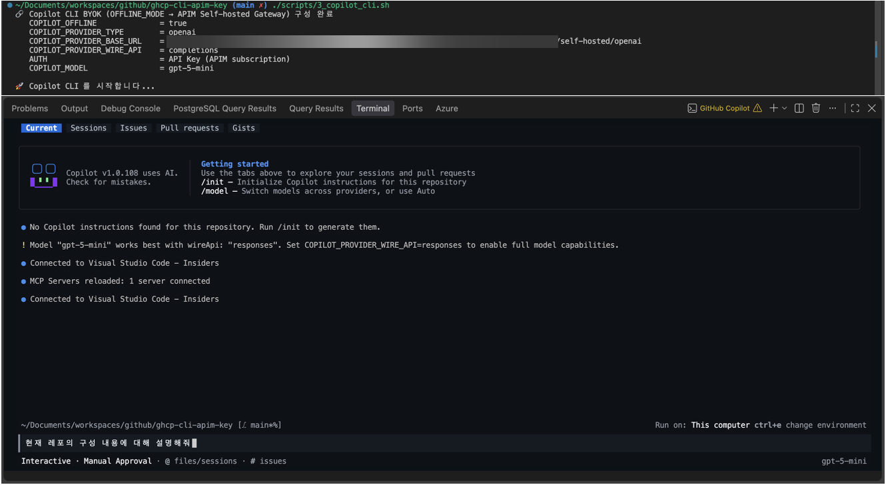
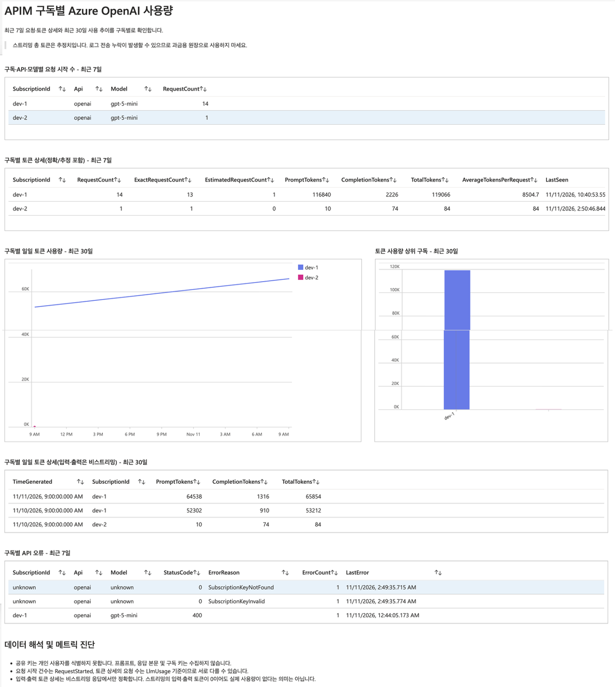
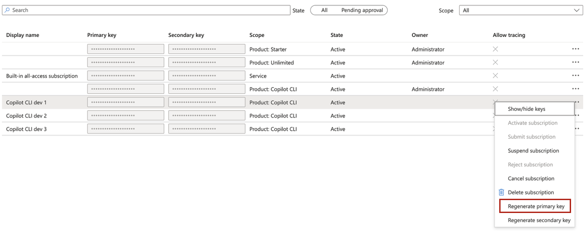
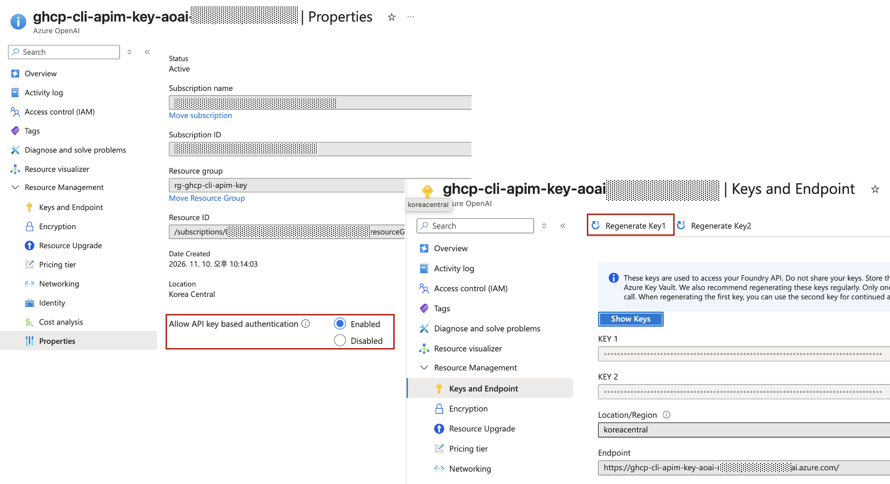

## 개요

망분리 환경에서 조직이 승인한 AI 서비스를 Copilot CLI에 연결하려는 운영자와 개발자를 위한 샘플입니다.
클라이언트가 Azure OpenAI를 직접 호출하는 대신 APIM Self-hosted Gateway를 거치도록 구성해,
모델 요청의 인증·토큰 한도·사용량 기록을 한곳에서 관리합니다.

Copilot CLI는 GitHub 로그인 없이 BYOK(Bring Your Own Key) offline 모드로 실행합니다.
개발자별로 발급한 APIM 구독 키로 Gateway를 호출하고, Gateway가 별도로 보관한 Azure OpenAI API 키로
모델에 접근합니다. Azure OpenAI 백엔드 키를 개발자에게 직접 배포하지 않습니다.

`feature/pii-filter` 브랜치에서는 같은 Azure Container App에 PII(개인 식별 정보) 필터 컨테이너를 추가해,
모델로 전달하기 전에 요청 본문을 검사합니다.

> [!NOTE]
> PII 검사 통과 시에만 모델을 호출하며, 탐지 또는 검사 실패 시 요청을 차단합니다.
> Azure 배포 순서는 `0_azd_up.sh → 1_build_pii_image.sh → 2_create_self_hosted_gateway.sh`입니다.
> 코드 구현과 실제 배포·종단 간 검증은 별개입니다. 비운영 환경에서 차단 동작을 검증한 뒤 적용하세요.

### 제공 기능

- Bicep과 스크립트를 이용한 APIM, Azure OpenAI, ACA Self-hosted Gateway 및 모니터링 리소스 구성
- 개발자별 APIM 구독 생성과 구독 키 기반 모델 호출 인증
- Gateway 정책을 통한 배포 모델 지정, 구독별 토큰 제한 및 사용량·오류 기록
- 같은 ACA replica의 PII sidecar를 통한 요청 검사, 개인정보 탐지 시 차단 및 검사 실패 시 fail-closed 처리
- Bicep ACR·이미지 pull identity 구성, ACR Build 스크립트와 JSON 파일 기반 탐지 규칙 관리
- Copilot CLI 실행, 키 인증 검증 및 Workbook을 이용한 구독별 사용량 조회

### Disclaimer

> [!IMPORTANT]
> 이 아키텍처는 참고용이며, Private Network 환경을 고려해 설계되지 않았습니다.
> Copilot CLI에서 APIM Self-hosted Gateway를 통해 모델을 호출하는 부분만 참고하세요.
> 폐쇄망이나 망분리 통제는 자동으로 구성하지 않으며, 실제 적용 시 조직의 요구사항에 맞춰 별도로 설계해야 합니다.
> 기본 배포는 ACA 외부 HTTPS ingress와 공개 Azure endpoint를 사용합니다.
> BYOK offline 모드는 GitHub 로그인 없이 자체 모델을 사용하는 방식이지, 외부 통신이 없는 완전 오프라인 실행을 뜻하지 않습니다.

## 아키텍처

APIM 보안 공지 `MZK9-GH0`의 확인 상태와 구독별 읽기 전용 점검은
[APIM 보안 공지 점검 가이드](docs/apim-advisory.md)를 참고하세요.
현재 구독은 `bash scripts/check_apim_advisory.sh`, 전체 접근 가능 구독은
`bash scripts/check_apim_advisory.sh --all`로 점검합니다.
조회 완료나 영향 목록에 없는 결과가 안전을 보장하지는 않습니다.

### ACA 2개 컨테이너 구성



화살표는 요청·설정·로그의 데이터 흐름이며, ACA 상자는 Container App 배포 경계입니다.
같은 replica의 Gateway와 PII 필터가 네트워크를 공유하고 함께 배포·확장됩니다.
외부 HTTPS ingress는 Gateway의 8080 포트에만 연결하며 PII 필터의 8000 포트는 외부에 노출하지 않습니다.
`localhost`는 Gateway의 호출 경로이며, 필터가 loopback 주소로만 수신한다는 뜻은 아닙니다.
필터는 ACA health probe 접근을 위해 `0.0.0.0:8000`으로 수신하고 필터 전용 키로 검사 API를 인증합니다.
설정 동기화는 Gateway가 APIM 구성 서비스에 접속해 설정을 내려받는 방식입니다.
요청 경로는 `CLI → Gateway → PII 검사 → Gateway → Azure OpenAI`입니다.

### 구성 요소의 역할

- APIM은 API·정책·Product·구독 및 백엔드 키를 관리합니다.
- Self-hosted Gateway는 동기화한 inbound 정책으로 PII 필터를 호출하고 검사 통과 시 Azure OpenAI를 직접 호출합니다. 모델 요청은 관리형 Gateway를 경유하지 않습니다.
- PII 필터는 요청 본문의 개인정보를 로컬에서 탐지하고 유형·건수·허용 또는 차단 판정을 반환합니다. Azure OpenAI를 직접 호출하거나 원문을 저장하지 않습니다.

이 샘플이 생성하는 API는 `self-hosted-openai`이며 별도 `openai` API는 생성하지 않습니다.
모델은 독립 Azure OpenAI 계정의 배포이며 Foundry 프로젝트 리소스는 생성하지 않습니다.

### PII 검사와 차단 동작

동작은 자동 마스킹이 아니라 요청 차단입니다.
코드·tool-call 인자를 자동 치환하면 Copilot 작업의 의미가 달라질 수 있기 때문입니다.
마스킹 모드는 별도 검토 후 선택 기능으로 추가하며, 초기 구현에는 포함하지 않습니다.

1. Gateway가 APIM 구독 키를 검증하고 관리형 Gateway 호출을 거절합니다.
2. 요청 크기·형식을 검증하고 클라이언트 인증 정보를 백엔드 전달 대상에서 제거합니다.
3. inbound 정책의 `send-request`로 `http://127.0.0.1:8000/inspect`를 호출합니다.
   원본 본문을 복사해 검사하며 요청 본문을 마스킹된 데이터로 교체하지 않습니다.
4. PII 필터가 본문을 검사하고 원문·실제 탐지값 없이 판정을 반환합니다.
5. 금지된 PII가 있으면 `403`을 반환하고 Azure OpenAI를 호출하지 않습니다.
6. 검사 통과 시 기존 모델 지정·토큰 제한·백엔드 인증 정책을 적용하고 Azure OpenAI로 전달합니다.

검사 서비스 장애도 통과로 취급하지 않는 fail-closed 동작을 적용합니다.
HTTP `200`만으로 허용하지 않고 판정 형식, 검사 완료 여부, 허용 여부까지 검증해야 합니다.

| 상황 | Gateway 응답 | Azure OpenAI 호출 |
|---|---|---|
| 전체 검사 완료 및 허용 판정 | 기존 모델 응답 전달 | 호출 |
| 정책상 금지된 PII·비밀정보 탐지 | `403` / `PII_DETECTED` | 호출하지 않음 |
| 잘못된 JSON | `400` / `INVALID_REQUEST` | 호출하지 않음 |
| 요청 본문 크기 초과 | `413` / `REQUEST_TOO_LARGE` | 호출하지 않음 |
| 지원하지 않는 본문 형식 | `415` / `UNSUPPORTED_CONTENT_TYPE` | 호출하지 않음 |
| 검사 시간 초과·서비스 장애·인증 실패·잘못되거나 불완전한 판정 | `503` / `PII_INSPECTION_UNAVAILABLE` | 호출하지 않음 |

PII 차단 응답에는 실제 탐지값 대신 유형·총 건수·규칙 버전·요청 ID만 포함합니다.
`message`는 개인정보 또는 비밀정보를 요청 문맥에서 제거하도록 안내합니다.

```json
{
  "error": {
    "code": "PII_DETECTED",
    "message": "Request blocked by the PII policy. Remove personal data or secrets from the request context and try again.",
    "requestId": "12345678-1234-1234-1234-123456789abc",
    "categories": ["EMAIL", "KOR_PHONE"],
    "matchCount": 2,
    "ruleVersion": "2026-11-15.3"
  }
}
```

정상 판정의 빈 탐지 유형은 trace에 `none`으로 기록합니다.
검사가 완료되지 않은 경우 규칙 버전은 `unknown`, 건수·시간은 `0`으로 기록하며,
이 값은 검사 성공을 뜻하지 않습니다. HTTP 판정은 계속 fail-closed 오류를 유지합니다.

### 검사 범위와 한계

- PII 탐지 대상은 한국 주민등록번호 형태(날짜·체크섬 검증 없음), 이메일, 한국 전화번호, Luhn 검증을 통과한 카드번호
- 계좌번호는 10~14자리 숫자(하이픈 허용)를 계좌 관련 문맥 또는 지정 JSON 필드와 조합해 탐지하며, 실제 발급·은행별 유효성을 보장하지 않음
- 비밀정보는 GitHub 토큰·AWS 접근 키 ID 형식, 본문이 있는 PEM 개인키, 서명 부분이 있는 JWT 형식, API 자격 증명 대입 및 접속 문자열의 비밀 값 탐지
- 초기 입력 형식은 현재 모델 API가 사용하는 UTF-8 JSON 요청 본문
- 검사 범위는 전체 대화의 텍스트, 코드·파일에서 가져온 컨텍스트, tool 응답 및 tool-call 인자의 문자열 데이터
- JSON 키·숫자값과 JSON으로 인코딩된 tool-call 인자에 포함된 식별정보도 검사
- 본문 한도 1 MiB, 중첩 깊이 한도 64, 규칙당 최대 평가 시간 50 ms 및 전체 탐지 시간 한도 3초

문자열로 인코딩된 JSON, 한글·영문 혼합, 구분자 변형과 긴 입력의 경계 사례를 검증해야 합니다.
입력을 잘라 일부만 검사하거나 검사 실패를 탐지 0건으로 처리하지 않습니다.
잘못된 JSON, 중복 키, 비표준 `NaN`·`Infinity`, 압축 본문은 거절합니다.
Gateway는 선언된 Content-Length를 먼저 확인하고 버퍼링 후 실제 크기도 검사합니다.
Content-Length가 없는 요청의 Gateway 버퍼링 자체를 제한하는 구성은 별도이며,
필터는 스트림의 누적 바이트가 한도를 넘는 즉시 거절합니다.
요청 본문을 임의로 변경하지 않고 허용된 요청의 JSON 구조와 tool-call 의미를 보존합니다.

이름·주소·여권번호, 임의 형식의 비밀번호·API 키와 모든 공급자의 토큰 탐지는 구현 범위 밖입니다.
비밀정보 규칙은 형식 기반 휴리스틱이며 실제 발급·유효성·JWT 서명을 확인하지 않습니다.
URL path·query·headers, 이미지·파일 원본과 모델 응답도 이 본문 필터로 보호되지 않습니다.
필요하면 한국어 NER, 추가 공급자별 비밀정보 탐지 및 콘텐츠별 검사 경로를 후속으로 검토합니다.
규칙 기반 탐지에는 오탐·미탐이 있으므로 PII 전체 차단이나 망분리 준수를 보장하지 않습니다.

초기 검증은 기존 CLI의 기본 비스트리밍 응답을 기준으로 합니다.
`stream: true`여도 JSON 요청 본문은 사전 검사 대상이지만, SSE 응답의 PII 검사는 별도 설계가 필요합니다.
CLI의 직접 외부 호출·MCP 통신과 Gateway를 우회한 모델 호출도 별도 통제 대상입니다.

### 배포·운영과 검증

공식 Gateway 이미지는 유지하고 PII 필터 이미지만 별도로 빌드해 동일 ACA 앱에 추가합니다.
현재 Gateway의 1 vCPU·2 GiB와 replica 1개 구성은 초기 기준으로 유지하고,
필터에는 0.5 vCPU·1 GiB를 할당합니다. 운영 값은 본문 크기·동시 요청 부하 시험으로 결정합니다.
두 컨테이너의 readiness를 확인하고, 확장·장애·revision 교체가 함께 일어나는 영향을 검증합니다.
필터 HTTP 서버의 동시 연결 한도는 32이며, 과부하의 `503`도 모델 호출 없이 차단합니다.

필터 호출 키는 백엔드 키·구독 키·Gateway 구성 토큰과 별도로 관리합니다.
ACA secret과 APIM의 Key Vault named value는 같은 버전의 필터 키를 사용하며,
원문·키를 소스·로그·명령 인수에 노출하지 않고 회전 시 양쪽 설정의 전환을 검증합니다.

Gateway는 `PiiInspection` 이벤트로 구독 ID·요청 ID·탐지 유형·건수·HTTP 판정·검사 시간·규칙 버전을 기록합니다.
기존 본문·인증 헤더 로그 비활성화는 유지하고, PII 필터 로그에도 원문·탐지값을 남기지 않습니다.
차단 요청은 모델 호출·모델 토큰 사용량과 구분해 집계합니다.

필터 구현과 Docker 빌드 컨텍스트는 [pii-filter/](pii-filter/)에 있습니다.
기존 [API 정책](apim/policies/openai-policy.xml)에 검사 단계를 병합했으며,
참고용 폴더의 코드·스크립트·이미지를 실행하거나 배포하지 않습니다. 참고 폴더를 삭제해도 동작합니다.

운영 적용 전에 다음 항목을 확인합니다.

- 차단 모드, 초기 탐지 유형, 1 MiB 한도 및 오류 응답에 대한 검토
- 기존 인증·모델 지정·토큰 제한·사용량 기록의 유지
- 실제 PII가 아닌 합성 데이터로 한국어·코드·중첩 JSON·숫자 식별정보 검사
- echo backend로 차단·검사 장애 시 백엔드 호출 0건 확인
- 허용 요청의 본문 의미와 CLI tool-call 동작 보존
- 필터 키 불일치·시간 초과·과대 요청·readiness 실패 및 로그 비노출 검증

### 코드와 분리한 PII 규칙 관리

권장 방식은 승인된 JSON 규칙 파일을 버전 관리하고 배포 시 ACA에 주입하는 것입니다.
[rules.json](pii-filter/rules.json)의 `version`과 각 규칙의 `id`, `enabled`, `pattern`, `validator`를 편집합니다.
`validator`는 `none` 또는 `luhn`을 지원하며, 패턴 추가·수정·비활성화에는 Python 코드 변경이 필요 없습니다.
추가 조건도 규칙별로 설정할 수 있습니다.

- `keywords`: 매치와 앞뒤 `context_window`자 안에 하나 이상 있어야 하는 문자열 목록. NFKC 정규화 후 대소문자를 구분하지 않는 부분 문자열로 검사합니다.
- `context_window`: 매치 앞뒤 문맥 길이. 기본 80자, 범위 0~1024자이며 `keywords`와 함께 사용합니다. 문맥은 같은 문자열 안에서만 찾습니다.
- `fields`: 검사할 JSON 필드 이름 목록. NFKC 정규화 후 대소문자를 구분해 정확히 비교합니다. 해당 필드의 스칼라 값과 배열 원소에 적용되며, 하위 객체는 자체 필드 이름을 사용합니다.
- `allowlist`: 해당 규칙에서 제외할 정확한 매치 문자열 목록. NFKC 정규화 후 대소문자를 구분하며, 다른 규칙의 탐지는 면제하지 않습니다.

`keywords`와 `fields`를 함께 지정하면 두 조건을 모두 만족해야 합니다.
두 목록은 각각 최대 32개이며 지정 시 비어 있을 수 없습니다.
`allowlist`는 최대 128개이고 빈 목록도 허용합니다. 각 항목은 공백만으로 구성할 수 없으며 최대 256자입니다.
조건을 생략한 기존 규칙은 계속 전체 JSON 키와 값을 검사합니다.
`fields`는 자연어 안의 필드 표기가 아니라 실제 JSON 구조에만 적용됩니다.
JSON으로 인코딩된 도구 인자는 파싱한 내부 필드에도 조건을 적용합니다.

기본 파일에는 계좌번호 문맥·필드 규칙과 비밀정보 규칙을 활성 상태로 포함합니다.
`INTERNAL_ID_FIELD_EXAMPLE`은 조직별 사번 체계를 설정하기 위한 비활성 예시입니다.
허용 목록은 승인된 테스트 값으로 좁게 유지하고 실제 개인정보를 저장소에 넣지 마세요.
새 필드를 처음 지원하는 이번 엔진 변경은 이미지 빌드와 재배포가 필요합니다.
갱신된 이미지 배포 이후에는 위 설정만 변경할 때 이미지 재빌드가 필요 없습니다.

#### 코드 생성 요청의 기본 정책

`email`, `phone`, `password`, `api_key` 같은 변수명·타입 선언 자체는 차단하지 않습니다.
코드, SQL, fixture, 로그와 도구 출력에 포함된 실제 값의 형식과 문맥을 검사하며 소스 코드 AST를 분석하지는 않습니다.

- 이메일은 로컬 부분(`@` 앞)이 1~64자인 형식을 검사하고, 정확한 `test@example.com`과 공개 Copilot 봇 주소 `223556219+Copilot@users.noreply.github.com`만 기본 예외입니다. 두 주소 모두 NFKC 정규화 후 대소문자를 구분합니다. 도메인 전체를 허용하지 않으며, 다른 이메일이 함께 있으면 계속 탐지합니다.
- CLI의 기본 커밋 공동작성자 안내에 포함된 봇 주소가 오탐되지 않도록, 전화번호 규칙은 정확한 봇 이메일 범위에만 `regex`의 `(*SKIP)(*F)`를 적용합니다. 이메일 밖의 같은 숫자, 다른 봇·사용자 주소, 접두사나 도메인 접미사를 붙인 유사 주소는 면제하지 않습니다. system 메시지 전체를 면제하지도 않습니다.
- 카드·전화·주민번호는 테스트처럼 보여도 기존 규칙을 적용합니다. 합성 데이터나 주석이라는 이유로 코드 블록 전체를 면제하지 않습니다.
- 계좌 문맥은 같은 문자열의 앞뒤 40자 안에서 `계좌`, `account_number`, `accountNumber`, `bank_account`, `bankAccount`, `bank account`를 찾습니다.
- 구조화된 계좌값은 `account_number`, `accountNumber`, `bank_account`, `bankAccount`, `계좌번호` 필드를 검사합니다. 필드명만 있고 값이 없으면 탐지하지 않습니다.
- 일반 API 자격 증명은 지정된 키 이름과 32~128자의 영문·숫자가 모두 있는 값(하이픈·밑줄 허용)을 조합합니다. 따옴표로 감싼 코드 대입이나 지정 JSON 필드에 적용하며, 같은 길이의 일반 체크섬은 이것만으로 차단하지 않습니다.
- 접속 문자열은 `Server=`, `Data Source=`, `Host=`, `AccountName=`, `DefaultEndpointsProtocol=` 문맥과 12~128자의 비밀 값을 조합합니다.
- `Password=YOUR_PASSWORD_HERE`, `AccountKey=YOUR_ACCOUNT_KEY_HERE`는 접속 문자열 규칙의 정확한 예외입니다. 환경변수 참조 `${...}`나 `<...>` 템플릿은 이 규칙의 실제 값으로 취급하지 않습니다.

서명·키 형식과 일치하는 테스트 토큰은 기본적으로 차단합니다.
예외 값은 규칙별로 평가되므로 다른 규칙이 탐지하면 요청은 계속 차단됩니다.
은행별 형식, 공급자별 토큰과 한국어 문맥은 운영 데이터 대신 합성 평가 데이터로 오탐·미탐을 확인하세요.
이름·주소 NER은 아직 포함하지 않았습니다.

이 봇 주소 오탐 수정은 규칙 파일만 변경하므로 2단계로 규칙을 다시 주입한 뒤 4단계를 실행하면 됩니다.
0단계 인프라 배포와 1단계 이미지 재빌드는 필요 없습니다.

```json
{
  "version": "custom.1",
  "rules": [
    {
      "id": "INTERNAL_ID",
      "enabled": true,
      "pattern": "EMP-[0-9]{4}",
      "validator": "none"
    }
  ]
}
```

위 JSON은 형식 예제이며 기본 개인정보 규칙 전체를 대체하면 기존 탐지 유형이 사라집니다.
기본 규칙을 유지한 채 필요한 규칙을 추가하고, 버전과 평가 테스트도 함께 갱신하세요.
모든 규칙 비활성화, 중복 ID, 잘못된 정규식은 필터 시작 실패로 처리합니다.

[Gateway 배포 스크립트](scripts/2_create_self_hosted_gateway.sh)는 파일 내용을 ACA의 `pii-rules` secret에 저장하고
필터의 `PII_RULES_JSON` 환경변수에 `secretRef`로 주입합니다. 규칙은 시작 시 한 번 검증·로드합니다.
규칙만 바꿀 때는 이미지 재빌드 없이 같은 digest 이미지로 앱을 갱신·재시작합니다.

```bash
# 기본 파일을 수정한 경우
./scripts/2_create_self_hosted_gateway.sh

# 별도 승인 파일을 사용하는 경우: 실제 azd 환경 이름을 지정합니다.
AZURE_ENV_NAME=dev PII_RULES_FILE=/absolute/path/to/approved-rules.json \
  ./scripts/2_create_self_hosted_gateway.sh
```

이 스크립트는 Gateway 구성 토큰도 함께 갱신합니다.
운영 중 규칙 교체는 단일 replica의 일시 중단을 고려해 수행하고 이전 승인 파일로 복구할 수 있게 보관하세요.
패턴은 Python `regex` 문법을 사용하며, 실행 시간 초과는 허용이 아니라 검사 실패로 처리합니다.
정규식만으로 이름·주소 등 문맥 기반 PII를 정확하게 탐지할 수는 없습니다.

중앙 관리가 필요하면 Azure App Configuration 또는 Blob Storage의 승인된 규칙 버전을
배포 파이프라인이 내려받아 `PII_RULES_FILE`로 전달하는 방식을 권장합니다.
이 중앙 저장소 연동·자동 동기화는 현재 구현하지 않았습니다.
필터가 요청마다 원격 규칙을 조회하는 방식은 피하고, 버전 고정·검증·승인·롤백 절차를 유지하세요.
새 검증 알고리즘이나 NER 엔진 추가는 JSON 패턴 변경과 별개로 코드·이미지 변경이 필요합니다.

### 인증과 자격 증명

| 구분 | 인증 및 자격 증명 |
|---|---|
| 리소스 배포·조회 및 구독 키 조회 | Azure CLI의 `az login`, Azure Developer CLI의 `azd auth login` 세션과 Azure 관리 권한 |
| Copilot CLI → Self-hosted Gateway | `Ocp-Apim-Subscription-Key` 헤더의 APIM 구독 키 |
| Self-hosted Gateway → Azure OpenAI | APIM의 Key Vault named value `openai-backend-key`에서 해석한 Azure OpenAI API 키를 `api-key` 헤더로 전달 |
| Gateway → APIM 구성 서비스 | ACA의 `gateway-token` secret에 보관한 별도의 Gateway 연결 토큰으로 구성·정책 동기화 |

Gateway → PII 필터 호출에는 `X-PII-Filter-Key` 헤더를 사용합니다.
APIM은 `pii-filter-key`에 지정된 Key Vault 버전을 사용합니다.
Gateway 배포 스크립트는 값이 아닌 버전만 읽고, Azure Resource Manager(ARM)가
동일 버전의 값을 배포 시 ACA secret에 주입합니다.
사용자의 APIM 구독 키나 Azure OpenAI 백엔드 키를 필터 인증에 재사용하지 않습니다.

Gateway는 API의 `subscriptionRequired: true` 설정에 따라 APIM 기본 구독 키 검증을 수행합니다.
키가 없거나 잘못되면 `401`로 거절하며, 정책 XML에서 동일한 키 비교를 다시 구현하지 않습니다.
구독 키는 개인 로그인 인증이 아니므로 같은 키를 공유하면 사용량과 토큰 한도도 같은 구독으로 집계합니다.

Azure 리소스 관리 로그인은 모델 API 호출 인증과 별개입니다.
현재 CLI 실행 스크립트는 시작 시 Azure 관리 API에서 리소스 정보와 APIM 구독 키를 조회하므로,
`az login` 세션과 해당 관리 권한이 필요합니다.
모델 호출은 키 기반으로 인증하며, CLI → Gateway는 APIM 구독 키, Gateway → Azure OpenAI는 Azure OpenAI API 키를 사용합니다.

## 필수 조건

- 모델 액세스 및 할당량이 있는 Azure 구독과 선택 모델·APIM SKU가 지원되는 지역
- 리소스 그룹, APIM, Azure OpenAI 및 모니터링 리소스를 생성할 권한
- APIM/ACA/모델 조회 및 APIM `subscriptions/read`, `subscriptions/listSecrets/action` 권한
- Bicep 배포 주체의 Azure OpenAI `accounts/listKeys/action` 권한
- ACR·user-assigned identity 생성과 ACR 범위의 `AcrPull` 역할 할당 권한
- 이미지 빌드 주체의 ACR Build·repository 메타데이터 조회 권한 및 ACA 배포 주체의 identity 할당 권한
- 인프라 배포 주체의 Key Vault·secret 관리 권한과 Vault 범위의 `Key Vault Secrets User` 역할 할당 권한
- Gateway 배포 주체의 APIM `namedValues/read`, ARM 배포 권한 및 대상 Vault의 `Microsoft.KeyVault/vaults/deploy/action` 권한
- Workbook 조회를 위한 대상 Log Analytics 로그 데이터 조회 권한

CLI 실행 계정에도 위의 리소스 조회·구독 키 읽기 권한이 필요합니다.
일반 사용자에게 관리 API 권한을 부여하지 않으려면 승인된 키 배포·리소스 설정 전달 방식을 별도로 구현해야 합니다.

<details>
<summary>CLI 및 실행 환경</summary>

Bash 3.2 이상과 다음 CLI들을 준비하세요.
사용 스크립트에는 [common.sh](scripts/common.sh)의 공통 함수를 통한 호출도 포함합니다.

| 도구·명령어 | 필요한 기능과 용도 | 사용 스크립트 |
|---|---|---|
| Azure Developer CLI (`azd`) | 로그인 완료, `azd env set --file` 지원, 환경값 조회 및 Bicep 인프라 배포 | [0_azd_up.sh](scripts/0_azd_up.sh), [1_build_pii_image.sh](scripts/1_build_pii_image.sh), [2_create_self_hosted_gateway.sh](scripts/2_create_self_hosted_gateway.sh), [3_create_subscription_key.sh](scripts/3_create_subscription_key.sh), [4_copilot_cli.sh](scripts/4_copilot_cli.sh) |
| Azure CLI (`az`) | 로그인 완료, `az containerapp` 명령 지원, ACR Build 및 Azure 리소스·Gateway·APIM 구독 관리·키 조회 | [1_build_pii_image.sh](scripts/1_build_pii_image.sh), [2_create_self_hosted_gateway.sh](scripts/2_create_self_hosted_gateway.sh), [3_create_subscription_key.sh](scripts/3_create_subscription_key.sh), [4_copilot_cli.sh](scripts/4_copilot_cli.sh) |
| GitHub Copilot CLI (`copilot`) | `COPILOT_PROVIDER_HEADERS` 지원 확인 및 BYOK offline 실행 | [4_copilot_cli.sh](scripts/4_copilot_cli.sh) |
| Node.js (`node`) | 입력 검증, JSON 처리, UUID 생성, CLI 로컬 릴레이 및 모델 응답 검증 | [1_build_pii_image.sh](scripts/1_build_pii_image.sh), [2_create_self_hosted_gateway.sh](scripts/2_create_self_hosted_gateway.sh), [3_create_subscription_key.sh](scripts/3_create_subscription_key.sh), [4_copilot_cli.sh](scripts/4_copilot_cli.sh) |
| `curl` | Gateway 상태 확인 및 구독 키 인증 HTTP 검증 | [2_create_self_hosted_gateway.sh](scripts/2_create_self_hosted_gateway.sh), [4_copilot_cli.sh](scripts/4_copilot_cli.sh)의 `--verify-only` |

이미지 빌드 스크립트도 Azure CLI·Node.js와 공통 환경 로드 규칙을 사용합니다.
ACR Build를 사용하므로 로컬 Docker CLI·데몬 없이 이미지를 빌드·저장할 수 있습니다.

`azd`는 0단계에서 필수이며, 1~4단계에서는 필요한 환경변수가 없을 때 azd 환경값 조회에 사용합니다.
4단계의 일반 CLI 실행은 로컬 릴레이를 위해 `node`가 필요하며,
`--verify-only`에서는 `curl`도 필요합니다. 이 검증 모드도 CLI 설정 지원 여부를 확인하므로 `copilot`이 필요합니다.

기본 OS 명령인 `env`, `dirname`, `date`, `mktemp`, `rm`, `rmdir`, `sleep`도 사용합니다.
Bicep은 `azd up` 배포 과정에서 사용하며, 스크립트가 별도 `bicep` 명령을 직접 호출하지는 않습니다.
Gateway 컨테이너는 ACA에서 실행하므로 로컬 Docker CLI는 필요하지 않습니다.

</details>

<details>
<summary>APIM SKU와 네트워크</summary>

이 아키텍처는 classic `Developer`와 `Premium`만 허용합니다.
두 계층은 VNet 주입과 self-hosted gateway를 지원하지만, `PremiumV2`는 classic `Premium`과 다릅니다.

| SKU | 용도 | VNet Injection | Self-hosted gateway |
|---|---|---|---|
| `Developer` | 개발 및 테스트 | 지원 | 지원 |
| `Premium` | 프로덕션 | 지원 | 지원 |

> [!IMPORTANT]
> SKU 지원과 실제 네트워크 구성은 다릅니다. [APIM 모듈](infra/modules/apim.bicep)은
> `publicNetworkAccess: 'Enabled'`, `virtualNetworkType: 'None'`을 사용합니다.
> [Azure OpenAI 모듈](infra/modules/openai.bicep)도 공개 접근을 허용하며, ACA는 HTTPS 외부 ingress로 배포합니다.
> VNet, 서브넷, Private Endpoint 및 프라이빗 DNS는 생성하지 않습니다.

</details>

### 망분리 환경에 적용할 때

운영 적용 전에는 조직의 보안 정책에 맞춰 다음 항목을 별도로 설계하고 승인받아야 합니다.

- Self-hosted Gateway 배포 방식: 이 샘플의 자동화는 ACA용이며 VM·Kubernetes 배포는 별도 구성
- 기업망에서 Gateway까지의 접근 경로와 필요한 사설 연결, 방화벽·프록시·DNS 설정
- Gateway의 APIM 설정 동기화, Azure OpenAI 모델 호출 및 모니터링 전송에 필요한 통신 경로
- 배포·관리 권한과 일반 사용자 권한의 분리, APIM 구독 키의 승인된 배포·회수 절차
- CLI 도구·플러그인·MCP 서버 및 실행 명령의 추가 통신에 대한 별도 통제

> [!IMPORTANT]
> CLI 실행에는 Gateway뿐 아니라 Azure 관리 API 접근도 필요합니다.
> 이 저장소의 설정만으로 망분리 준수 또는 외부 통신 차단을 보장하지 않습니다.

### 방화벽 허용 목록

현재 `feature/pii-filter` 브랜치의 공개 엔드포인트 기반 ACA 배포를 기준으로 합니다.
Source는 연결을 시작하는 주체이며, Port는 Target의 목적지 포트입니다.
각 행은 `Source의 Outbound → Target의 Inbound`를 의미합니다.
예를 들어 사용자 PC에서 Gateway로 보내는 요청은 사용자 PC 기준 Outbound, Gateway 기준 Inbound입니다.
Gateway에서 APIM·Azure OpenAI로 보내는 요청은 Gateway 기준 Outbound, 각 서비스 기준 Inbound입니다.
공개·사설 경로 모두 같은 기준을 사용하며, 실제 규칙은 해당 구간의 방화벽·NSG·서비스 네트워크 제어에 적용하세요.
Target의 Inbound 표시는 연결을 받는 방향을 뜻하며, 관리형 서비스마다 별도의 NSG 규칙을 생성하라는 의미는 아닙니다.
`<...>`는 실제 배포값으로 바꾸세요. 아래 목록은 방화벽을 자동으로 구성하지 않습니다.

모델 요청 경로는 `사용자 → Self-hosted Gateway → PII 검사 → Gateway → Azure OpenAI`입니다.
APIM은 모델 요청을 중계하지 않으며, Gateway가 APIM 구성 서비스에 접속해 정책과 구독 정보를 동기화합니다.
main과 비교하면 같은 ACA replica 내 PII 검사 통신과 PII 이미지 빌드·다운로드 경로가 추가됩니다.

#### 모델 호출 및 Gateway 운영

| Source (Outbound)              | Target (Inbound)                                                  | Port       | 용도 및 적용 조건                                           |
|--------------------------------|-------------------------------------------------------------------|------------|------------------------------------------------------------|
| 사용자 PC / Copilot CLI         | ACA Gateway FQDN `<app>.<환경 도메인>.azurecontainerapps.io`        | TCP 443    | 모델 요청, Gateway 상태 확인                                |
| Self-hosted Gateway            | `<APIM명>.configuration.azure-api.net`                             | TCP 443    | API·정책·구독 동기화 및 상태 보고                            |
| Self-hosted Gateway            | APIM 인스턴스 주 지역의 공인 IP                                    | TCP 443    | Microsoft 문서상 필수 대상, 구성 FQDN과 IP가 같으면 중복 제거 |
| Self-hosted Gateway            | PII sidecar `127.0.0.1`                                           | TCP 8000   | 동일 replica 내 HTTP 검사 요청, 외부 방화벽 개방 불필요       |
| ACA 플랫폼 health probe        | PII sidecar의 `/healthz`                                          | TCP 8000   | startup·readiness·liveness 확인, 외부 사용자 접근용 아님      |
| Self-hosted Gateway            | `<OpenAI계정명>.openai.azure.com`                                  | TCP 443    | PII 검사 통과 시에만 Azure OpenAI 모델 호출                  |
| 사용자 PC 및 Gateway 실행 환경 | 조직 또는 실행 플랫폼에서 지정한 DNS 서버                         | UDP/TCP 53 | 대상 FQDN 이름 해석                                         |

PII 필터는 로컬 규칙으로 검사하므로 외부 PII 분석 서비스나 별도 모델 API에 접속하지 않습니다.
필터는 probe 접근을 위해 `0.0.0.0:8000`으로 수신하지만 외부 ingress에는 연결하지 않습니다.
외부 방화벽 개방이 불필요하다는 의미이지 loopback에만 바인딩되거나 네트워크 격리가 보장된다는 뜻은 아닙니다.
같은 replica의 loopback 검사 통신도 송신·수신 방향으로 표기했지만, 외부 네트워크 경계를 통과하는 통신은 아닙니다.
검사 API의 필터 전용 키 인증을 유지하세요.

Copilot CLI와 ACA는 Key Vault에 직접 연결하지 않으므로 온프레미스 CLI 방화벽이나 ACA 송신 규칙을 추가할 필요가 없습니다.
Vault 방화벽은 기본 거부이며, APIM 관리 영역은 시스템 할당 관리 ID와
[신뢰할 수 있는 Microsoft 서비스 예외](https://learn.microsoft.com/en-us/azure/api-management/api-management-howto-properties#requirements-for-key-vault-firewall)를 사용합니다.
ARM은 배포 시에만 Vault에서 PII 키를 읽습니다. 초기 키를 별도 Vault에서 가져오는 배포 PC나 운영자는
해당 원본 Vault의 데이터 영역 접근 조건을 별도로 충족해야 합니다.

#### 모니터링 및 조건부 통신

| Source (Outbound)   | Target (Inbound)                                                                        | Port    | 용도 및 적용 조건                                                        |
|---------------------|-----------------------------------------------------------------------------------------|---------|-------------------------------------------------------------------------|
| Self-hosted Gateway | Application Insights 연결 문자열의 `IngestionEndpoint` 호스트                            | TCP 443 | 요청·오류·PII 판정 메타데이터·토큰 사용량 전송                             |
| Self-hosted Gateway | `dc.services.visualstudio.com`, `rt.services.visualstudio.com`                            | TCP 443 | Microsoft가 안내하는 Application Insights 통합 대상, 실제 수집 설정 확인 |
| Self-hosted Gateway | `<region>.livediagnostics.monitor.azure.com`                                             | TCP 443 | Application Insights Live Metrics 사용 시                               |
| Self-hosted Gateway | APIM에 연결된 `<스토리지계정명>.blob.core.windows.net`, `<스토리지계정명>.table.core.windows.net` | TCP 443 | v2에서 API inspector 또는 quota 정책 사용 시 조건부 필요                 |

Application Insights는 실제 연결 문자열과
[Azure Monitor 네트워크 요구사항](https://learn.microsoft.com/en-us/azure/azure-monitor/fundamentals/azure-monitor-network-access)을 확인해
사용 중인 수집 기능의 대상만 허용하세요.
조건부 Storage 대상은 임의의 계정이 아니라 Azure Portal의 APIM 네트워크 연결 상태에 표시된 연결 계정입니다.
현재 정책의 `llm-token-limit`과 별도로, 추가하는 quota 정책의 Storage 의존성을 확인하세요.
PII 원문이나 실제 탐지값은 로그로 전송하지 않습니다.

#### 현재 실행 스크립트 및 배포·관리

| Source (Outbound)            | Target (Inbound)                                               | Port    | 용도 및 적용 조건                                         |
|------------------------------|----------------------------------------------------------------|---------|----------------------------------------------------------|
| 사용자 PC / 배포·관리 PC      | `management.azure.com`                                         | TCP 443 | 실행 전 리소스·APIM 구독 키 조회, 리소스 배포·관리          |
| 사용자 PC / 배포·관리 PC      | `login.microsoftonline.com` 및 테넌트 로그인에 필요한 엔드포인트 | TCP 443 | Azure 로그인·토큰 갱신, 인증 방식별 추가 대상 확인          |
| Gateway 컨테이너 실행 플랫폼 | `mcr.microsoft.com`, `*.data.mcr.microsoft.com`                  | TCP 443 | 공식 Gateway 이미지 다운로드·갱신                        |
| ACA 실행 플랫폼              | `<ACR명>.azurecr.io` 및 ACR이 반환하는 이미지 다운로드 엔드포인트 | TCP 443 | PII 필터 이미지 pull, 사용자 할당 identity의 `AcrPull` 사용 |
| 이미지 빌드·배포 PC           | ACR 및 빌드 컨텍스트 업로드·로그 조회에 사용되는 Storage 대상    | TCP 443 | `az acr build` 제출·결과 조회 및 이미지 digest 조회         |
| ACR Build 실행 환경          | Docker Hub 및 이미지 레이어 다운로드 대상                      | TCP 443 | PII Dockerfile의 `python:3.13-slim-bookworm` 베이스 pull    |
| ACR Build 실행 환경          | `pypi.org`, `files.pythonhosted.org`                            | TCP 443 | Python 패키지·빌드 의존성 설치, 사내 미러 사용 시 대상 변경 |
| ACR Build 실행 환경          | 대상 ACR 및 이미지 데이터 엔드포인트                            | TCP 443 | 빌드한 PII 이미지 push                                   |

ACR 이미지 다운로드 대상은 레지스트리 설정에 따라 전용 데이터 FQDN 또는 Storage 대상이 될 수 있습니다.
실제 반환되는 대상과 네트워크 요구사항을 확인하고, 공유 Storage 도메인 전체를 무조건 허용하지 마세요.
[이미지 빌드 스크립트](scripts/1_build_pii_image.sh)는 로컬 Docker가 아니라 원격 ACR Build를 사용하므로,
배포 PC와 빌드 실행 환경의 허용 경로를 구분해야 합니다.
[CLI 실행 스크립트](scripts/4_copilot_cli.sh)는 시작할 때 Azure 관리 API에서 리소스 정보와 구독 키를 조회합니다.
일반 사용자에게 이 통신과 관리 권한을 허용하지 않으려면, 승인된 설정·키 배포 방식을 별도로 구현해야 합니다.

- 외부 클라이언트는 TCP 443만 사용하며, ACA가 컨테이너 내부 TCP 8080으로 전달하므로 8080과 PII용 8000을 외부에 개방하지 않습니다.
- Gateway가 설정 동기화를 시작하므로 APIM에서 Gateway로 새 연결을 시작하는 인바운드 규칙은 필요하지 않습니다.
- 상태 기반 방화벽에서는 허용한 연결의 응답 트래픽을 반환 경로로 처리합니다.
- 응답을 위해 Target에서 Source로 새 연결을 시작하는 반대 방향 규칙을 추가하지 않습니다. 비상태 기반 ACL은 응답용 임시 포트 범위를 별도 검토해야 합니다.
- FQDN과 실제 해석되는 IP가 모두 접근 가능해야 합니다. IP 기반 규칙은 주소 변경을 추적해야 합니다.
- Private Endpoint나 사설 Gateway를 도입하면 대상 주소·라우팅·Private DNS를 해당 구성에 맞게 변경해야 합니다.
- ACA 플랫폼 자체의 전체 네트워크 의존성, 도구 설치·업데이트, 플러그인·MCP 및 실행 명령의 추가 통신은 별도 검토 대상입니다.

Gateway 필수·조건부 대상은
[Microsoft Self-hosted Gateway 연결 요구사항](https://learn.microsoft.com/en-us/azure/api-management/self-hosted-gateway-overview#fqdn-dependencies)을 참고하세요.

### Private Network 적용 시 추가 고려사항

> [!IMPORTANT]
> 현재 저장소는 Private Network 구성을 구현하거나 검증하지 않았습니다.
> 아래 내용은 별도 설계·구현 시 검토할 항목이며, 앞의 공개 엔드포인트 방화벽 목록을 그대로 적용하거나
> `publicNetworkAccess`만 비활성화해서는 사설 통신이 구성되지 않습니다.

사용자 진입 경로, Gateway의 모델 호출, APIM 설정 동기화, 모니터링 및 배포·관리를 각각 구분해 설계하세요.
모델 요청을 사설화해도 다른 경로까지 자동으로 사설화되지는 않습니다.
PII sidecar는 main과 다른 내부 검사 단계일 뿐 사설망 연결을 제공하거나 Gateway 우회를 차단하지 않습니다.

| 검토 영역                  | Private Network에서 별도로 구성할 사항                                                                                                                              |
|----------------------------|---------------------------------------------------------------------------------------------------------------------------------------------------------------------|
| 기업망과 Azure 연결        | VPN 또는 ExpressRoute, VNet 피어링, 주소 대역 중복 방지, 왕복 라우팅을 구성합니다. Gateway·Private Endpoint 사설 IP까지 실제 접근 가능한지 확인합니다.                 |
| Gateway 배포 환경          | ACA에 사용자 VNet과 전용 서브넷을 구성하고, 내부 환경 또는 지원되는 환경 Private Endpoint 방식을 선택합니다. 기본 네트워크 환경에서 전환하려면 환경 재생성이 필요할 수 있습니다. |
| ACA ingress 범위           | 환경의 사설 진입 경로와 앱 ingress 범위를 함께 설계합니다. 앱의 `external: false`는 같은 ACA 환경 내부로 접근을 제한하므로 기업망 사용자용 사설 진입 설정과 같지 않습니다. |
| Azure OpenAI               | Private Endpoint와 Private DNS를 구성하고 Gateway VNet에서 접근을 검증한 뒤 공개 접근을 차단합니다. 기존 모델 FQDN을 유지하고 DNS가 사설 IP를 반환하게 합니다.           |
| APIM 구성 서비스           | Gateway에서 v2 구성 엔드포인트로 사설 연결이 필요합니다. 현재 지원 SKU인 classic Developer/Premium의 내부 VNet 주입과 구성 엔드포인트 DNS·라우팅을 검토합니다.             |
| APIM Private Endpoint 범위 | APIM의 일반적인 inbound Private Endpoint만으로 Self-hosted Gateway 구성 엔드포인트나 Azure 관리 API까지 사설화된다고 가정하지 마세요. 지원 대상과 SKU 제약을 확인합니다. |
| DNS                        | Private DNS Zone의 VNet 연결과 온프레미스 조건부 전달을 구성합니다. 필요하면 Azure DNS Private Resolver를 사용하고, 사용자 PC와 Gateway 양쪽의 이름 해석을 검증합니다.     |
| 방화벽 및 아웃바운드       | NSG, UDR, Azure Firewall 또는 프록시 정책을 함께 설계합니다. ACA 플랫폼 필수 통신과 APIM 자체의 VNet 의존성은 애플리케이션 통신과 별도로 허용해야 합니다.                   |
| 로그·메트릭                | Azure Monitor Private Link Scope(AMPLS), 모니터링 리소스 연결 및 Private DNS를 검토합니다. 사용 중인 수집·조회·Live Metrics 기능의 사설 연결 지원 여부를 확인합니다.        |
| PII sidecar                | 같은 replica의 HTTP 검사 경로와 probe를 유지하고 8000을 외부 ingress에 연결하지 않습니다. 네트워크 변경 후에도 필터 키 인증과 검사 실패 시 fail-closed를 검증합니다.        |
| ACR SKU 및 사설 연결       | 현재 ACR은 Basic·공개 접근입니다. Private Endpoint를 사용하려면 Premium SKU로 변경하고 레지스트리·데이터 엔드포인트의 Private DNS와 접근 경로를 구성해야 합니다.              |
| 이미지 및 의존성 공급      | 공식 Gateway와 Python 베이스 이미지를 승인된 사설 레지스트리로 반입하고 Python 패키지 미러를 검토합니다. 현재 Gateway 이미지 설정과 PII Dockerfile·빌드 설정을 함께 수정합니다. |
| 사설 ACR 빌드              | 기본 `az acr build`가 사설 ACR에 자동 접근한다고 가정하지 마세요. 지원 지역·SKU를 확인한 VNet 연결 ACR Tasks agent pool 또는 사설망 빌드 실행기를 별도 구성합니다.            |
| 배포·관리 실행 위치        | 사설 Gateway·ACR에 접근하는 스크립트와 CI 실행기를 해당 네트워크에 배치합니다. Azure 관리 API·Entra 인증 통신은 별도 승인하고 사용자 실행 시 구독 키 조회 방식을 재검토합니다. |
| TLS 및 자격 증명           | 사설망에서도 HTTPS, 인증서 호스트 이름 검증, APIM 구독 키·Gateway 연결 토큰·PII 필터 키의 보호·갱신을 유지합니다. 사내 CA 사용 시 클라이언트·컨테이너 신뢰 저장소를 구성합니다. |

#### 사설 통신 경로의 방화벽 검토 예시

아래는 사설 연결을 별도로 구현한 뒤의 논리적 허용 경로입니다.
환경별 실제 사설 IP·서브넷과 정책으로 구체화해야 하며, 플랫폼·관리 통신을 포함한 전체 허용 목록은 아닙니다.
기존 공개 IP 규칙은 사설 전환 검증 후 필요한 항목만 대체하거나 제거하세요.

| Source (Outbound)              | Target (Inbound)                                              | Port       | 전제 조건                                          |
|--------------------------------|---------------------------------------------------------------|------------|---------------------------------------------------|
| 기업망 사용자 PC               | Gateway의 사설 진입 IP 또는 내부 프록시 IP                     | TCP 443    | VPN/ExpressRoute 등 사설 경로와 Gateway FQDN 해석   |
| Self-hosted Gateway            | APIM v2 구성 엔드포인트의 사설 IP                              | TCP 443    | 내부 VNet 구성 및 구성 FQDN의 사설 DNS·라우팅       |
| Self-hosted Gateway            | PII sidecar `127.0.0.1`                                        | TCP 8000   | 기존 replica 내부 HTTP 통신 유지, 외부 개방 불필요 |
| Self-hosted Gateway            | Azure OpenAI Private Endpoint IP                              | TCP 443    | 모델 FQDN이 해당 사설 IP로 해석                     |
| Self-hosted Gateway            | AMPLS를 통해 연결한 모니터링 수집 엔드포인트의 사설 IP          | TCP 443    | 해당 수집 기능의 Private Link 지원 및 DNS 구성     |
| ACA 실행 플랫폼 및 빌드 실행기 | ACR 레지스트리·데이터 엔드포인트의 사설 IP                     | TCP 443    | Premium·Private Endpoint·DNS 및 이미지 pull/push 권한 |
| 사용자 PC 및 Gateway 실행 환경 | 각 네트워크에서 지정한 DNS 서버·Resolver                       | UDP/TCP 53 | 온프레미스와 Azure 간 DNS 전달 경로 구성            |

현재 [Gateway 배포 스크립트](scripts/2_create_self_hosted_gateway.sh)는 공개 ingress를 설정하고,
[CLI 실행 스크립트](scripts/4_copilot_cli.sh)는 기본 APIM 구성 FQDN과 Azure 관리 API 조회를 전제로 합니다.
[ACR 모듈](infra/modules/registry.bicep)은 Basic SKU와 공개 접근을 설정하며,
[이미지 빌드 스크립트](scripts/1_build_pii_image.sh)는 사설 빌드용 agent pool을 지정하지 않습니다.
사설 배포에 맞게 스크립트와 인프라를 함께 수정해야 하며, 기존 배포 재실행으로 공개 설정이 복원되지 않도록 해야 합니다.

전환 후에는 사용자 PC와 Gateway 각각에서 DNS 결과, TCP 443 연결 및 TLS 인증서를 확인하세요.
실제 모델 호출뿐 아니라 Gateway 재시작 후 초기 구성 다운로드, 정책·구독 변경 반영, 로그 수집과 이미지 재배포도 검증해야 합니다.
합성 데이터로 PII 허용·차단, 필터 장애 시 모델 호출 차단, 두 컨테이너의 readiness 및 필터 키 교체도 검증하세요.
외부 네트워크에서 사설화한 서비스와 PII 포트에 접근할 수 없는지도 확인하세요.

관련 제약과 구성 절차는 [ACA 네트워킹](https://learn.microsoft.com/en-us/azure/container-apps/networking),
[APIM Private Endpoint](https://learn.microsoft.com/en-us/azure/api-management/private-endpoint),
[APIM 내부 VNet의 구성 서비스 연결](https://learn.microsoft.com/en-us/azure/api-management/self-hosted-gateway-overview#connectivity-in-an-internal-virtual-network),
[ACR Private Endpoint](https://learn.microsoft.com/en-us/azure/container-registry/container-registry-private-endpoints),
[ACR Tasks agent pool](https://learn.microsoft.com/en-us/azure/container-registry/tasks-agent-pools)을 참고하세요.

## 배포 및 실행 순서

> [!NOTE]
> 인프라 배포는 PII 검사 정책을 먼저 적용합니다.
> 이미지 빌드와 2컨테이너 앱 배포를 완료하기 전에는 모델 요청이 `503`으로 차단될 수 있습니다.
> 기존 환경 업그레이드는 작업 시간을 확보한 뒤 아래 순서대로 진행하세요.

### 0. 설정과 APIM·모델 배포

먼저 대상 환경에서 OpenAI API 키 인증을 허용하는지 확인하세요.
조직 정책이 로컬 인증을 금지하면 `disableLocalAuth: false`를 사용하는 배포 또는 백엔드 키 조회가 실패할 수 있습니다.
[Azure OpenAI 모듈](infra/modules/openai.bicep)에는 `SecurityControl=Ignore` 태그도 포함되어 있으므로
조직의 정책·승인 요구사항을 확인한 뒤 배포하세요. 이 태그 자체가 정책 예외 승인을 보장하지는 않습니다.

`az login`과 `azd auth login`은 대상 테넌트에 이미 완료되어 있다고 가정합니다.
[설정 예제](.env.example)를 복사한 뒤 구독, 테넌트, 지역, 게시자 및 모델 설정을 편집하세요.
키 값은 넣지 않습니다.

```bash
cp .env.example .env
# .env 값을 편집합니다. 기존 환경에서는 복사로 덮어쓰지 마세요.
azd env new dev  # 최초 한 번만 실행합니다.
azd env set-secret PII_FILTER_KEY -e dev  # 최초 배포 또는 기존 환경 전환 시에만 실행합니다.
./scripts/0_azd_up.sh
azd env unset PII_FILTER_KEY -e dev  # 배포가 성공하면 입력 참조만 제거합니다.
```

최초 배포에는 승인된 원본 Key Vault에서 32자 이상의 무작위 URL-safe 필터 키를 지정하세요.
기존 환경을 전환할 때는 서비스 영향을 줄이기 위해 현재 사이드카와 APIM이 쓰는 **동일한** 필터 키를
승인된 비밀 관리 경로로 준비해 지정하세요. 기존 키를 사용하지 못하면 점검 시간에 두 배포를 진행하세요.
대상 Vault에 `pii-filter-key`가 이미 있으면 일반 재배포에서는 `set-secret`과 `unset`을 생략합니다.
역할 할당 직후 APIM이 Vault 접근 오류를 반환하면 권한 전파를 기다린 뒤 재배포하세요.
Vault에 필터 키가 이미 생성됐다면 재시도 전에 `azd`의 입력 참조를 제거해 버전을 다시 생성하지 않습니다.

[0_azd_up.sh](scripts/0_azd_up.sh)는 저장소 루트의 `.env`를
`azd env set --file .env`로 가져온 뒤 `azd up`을 실행합니다.
동명 설정은 덮어쓰지만 파일에 없는 기존 azd 환경값은 유지합니다.
`--environment dev` 또는 `-e dev`를 전달하면 설정도 해당 환경에 가져옵니다.

[main.bicep](infra/main.bicep)과 [매개변수 파일](infra/main.parameters.json)은 다음을 구성합니다.

- 작업 영역 기반 Application Insights, Log Analytics, 사용량 Workbook 및 APIM 서비스의 GatewayLogs 진단 설정
- API 키 인증을 활성화한 Azure OpenAI 계정 및 모델 배포
- APIM 서비스, 전용 Key Vault 및 APIM 시스템 할당 관리 ID의 `Key Vault Secrets User` 역할
- `openai-backend-key`: Key Vault의 Azure OpenAI KEY 1을 버전 없이 참조
- `pii-filter-key`: APIM과 ACA가 함께 사용할 Key Vault secret 버전을 고정해 참조
- Basic ACR(admin 계정 비활성화), 이미지 pull용 user-assigned identity와 ACR 범위의 `AcrPull` 역할
- 구독 필수 `self-hosted-openai` API와 `POST /self-hosted/openai/chat/completions` 통합 정책
- 구독 필수 Product `copilot-cli`(API를 묶는 단위)와 API 연결

Bicep은 클라이언트용 subscription이나 키를 생성하지 않습니다.
`APIM_SUBSCRIPTION_ID`는 CLI에서 사용할 APIM 구독 식별자이며,
[.env.example](.env.example)의 설정값은 `dev-1`입니다.
Product ID `copilot-cli`와는 별개이며, Azure 구독 ID나 인증 키 자체도 아닙니다.
`dev-1`로 지정하면 해당 구독의 키로 호출하고 사용량과 토큰 한도도 `dev-1` 기준으로 관리합니다.
환경값이 없을 때 인프라 매개변수의 기본값은 `copilot-cli`이지만, CLI 실행에는 `APIM_SUBSCRIPTION_ID` 설정이 필요합니다.
배포 출력에도 이 식별자만 포함되며, 해당 subscription이 생성되었음을 의미하지는 않습니다.
새 환경에서는 3단계 스크립트로 subscription을 생성한 뒤 CLI를 실행하세요.
키 값은 배포 출력에 포함하지 않습니다.
설정 예제의 모델은 `gpt-5-mini`, 버전 `2025-08-07`입니다.
모델 배포는 `OnceCurrentVersionExpired` 자동 버전 업그레이드를 허용하므로 실제 버전은 이후 달라질 수 있습니다.
지역별 모델 가용성 및 TPM 할당량에 맞춰 [.env.example](.env.example)의 모델·용량 값을 조정하세요.
배포 출력은 선택한 azd 환경에 저장됩니다.


#### 환경 설정 로드 규칙

1~4단계의 [공통 모듈](scripts/common.sh)은 다음 순서로 값을 읽습니다.

- `AZURE_ENV_NAME`이 없으면 루트 `.env`를 로드하며, 같은 이름의 기존 환경변수도 덮어씁니다.
- `AZURE_ENV_NAME`이 있으면 루트 `.env`를 읽지 않고 프로세스 환경변수를 사용합니다.
- 필수 설정이 비어 있을 때만 `azd env get-value`로 조회하며, azd 환경 전체를 일괄로 불러오지는 않습니다.

### 1. PII sidecar 이미지 빌드와 ACR 저장

0단계 후 다음을 실행합니다.

```bash
./scripts/1_build_pii_image.sh
```

[1_build_pii_image.sh](scripts/1_build_pii_image.sh)는 Bicep 출력 `ACR_NAME`을 조회하고
[pii-filter/](pii-filter/)만 ACR Build에 전달해 `linux/amd64` 이미지를 빌드·저장합니다.
timestamp와 랜덤 suffix의 고유 태그로 빌드한 뒤 digest를 조회합니다.
`<login-server>/pii-filter@sha256:<digest>` 형태의 `PII_FILTER_IMAGE`를 출력하고,
azd가 있으면 선택한 환경에도 저장합니다. 빌드·digest 조회 실패 시 성공 이미지 설정을 저장하지 않습니다.

azd 환경 없이 실행한다면 출력된 실제 `PII_FILTER_IMAGE`를 환경변수로 설정해야 합니다.
`latest`나 변경 가능한 태그는 Gateway 배포 스크립트에서 허용하지 않습니다.
규칙 파일만 변경하는 경우 이 빌드는 필요하지 않습니다.

### 2. ACA self-hosted gateway와 PII sidecar 구성

```bash
./scripts/2_create_self_hosted_gateway.sh
```

[2_create_self_hosted_gateway.sh](scripts/2_create_self_hosted_gateway.sh)는 실제 APIM의
리소스 그룹과 지역을 조회하고 다음을 구성합니다.
`Microsoft.App` 리소스 공급자와 필요한 관리 권한은 미리 준비하세요.

- Bicep이 배포한 `self-hosted-openai` API, 백엔드 키 named value, 버전이 지정된 PII 키 참조 확인
- Self-hosted gateway 등록과 기존 API의 gateway 연결
- ACA 환경과 HTTPS 외부 ingress의 Container App
- 신규 환경과 앱의 `Consumption` profile 구성
- 공식 `mcr.microsoft.com/azure-api-management/gateway:v2` 이미지
- Gateway 연결 토큰의 ACA secret 저장 및 `secretRef` 참조
- ACR digest 이미지의 PII sidecar, pull identity 연결 및 Gateway와 필터의 readiness probe
- 필터 전용 키·JSON 규칙의 ACA secret 저장 및 `secretRef` 참조
- Gateway 1 vCPU·2 GiB, 필터 0.5 vCPU·1 GiB, 최소·최대 replica 1개

API·operation·Product 연결·정책·진단은 Bicep에서 관리합니다.
이 스크립트는 Gateway 등록·API 연결과 ACA 앱 설정을 갱신하며, API 정책이나 백엔드 키를 갱신하지 않습니다.
`ACR_NAME`, `ACR_PULL_IDENTITY_ID`, digest 기반 `PII_FILTER_IMAGE`가 필요합니다.
기본 규칙은 [rules.json](pii-filter/rules.json)이며 `PII_RULES_FILE`로 다른 승인 파일을 지정할 수 있습니다.

앱 생성·업데이트는 [ARM 템플릿](scripts/container-app.template.json)으로 배포합니다.
일부 Azure CLI `containerapp` 확장의 YAML 업데이트가 빈 사용자 할당 ID 객체를 제거하는 문제를 피하기 위한 방식입니다.
PII 키 값은 배포 PC, 로컬 임시 파일 또는 배포 명령 인수를 거치지 않습니다.
스크립트는 provisioning 완료(최대 약 10분)를 기다린 뒤 새 revision의 readiness,
Gateway 상태와 구독 키 없는 요청의 거절 여부를 확인합니다. 배포 실패·취소·시간 초과는 오류로 종료합니다.
모델 호출 검증은 4단계에서 하며 PII 차단·장애 검증은 별도로 수행해야 합니다.
같은 이름으로 재실행하면 환경을 재사용하고 앱과 연결 토큰을 갱신·재시작합니다.
이름과 이미지는 [.env.example](.env.example)의 `SELF_HOSTED_GATEWAY_*`로 지정할 수 있습니다.

인프라 배포와 이미지 빌드가 성공한 뒤 ACA 배포만 실패했다면 이 2단계부터 다시 실행하세요.
코드·이미지 변경이 없으면 0단계나 1단계를 반복할 필요가 없습니다.
이전에 다른 프로젝트에서 설정한 `ACR_NAME`, `ACR_PULL_IDENTITY_ID`, `PII_FILTER_IMAGE`가 셸에 남아 있으면
값을 해제하고 현재 azd 환경의 배포 출력을 사용하세요.



> [!IMPORTANT]
> Gateway 연결 토큰의 만료·갱신 주기와 절차는 [키 교체 주기와 방법](#키-교체-주기와-방법)을 참고하세요.
> APIM 구독 키와는 별개의 자격 증명입니다.

ACA 환경의 기본 로그 저장은 비활성화하며 기존 환경의 로그 설정은 변경하지 않습니다.
기존 ACA 환경은 Consumption 실행을 지원해야 합니다.
최소 replica 1개를 유지하므로 사용하지 않아도 비용이 발생할 수 있으며, 기존 Dedicated profile 비용도 별도로 확인하세요.
APIM 사용량은 기존 Application Insights에 기록됩니다.
ACA 및 gateway 요금과, Bicep 밖에서 생성한 후속 리소스의 정리 수명 주기를 별도로 관리하세요.

#### 운영 시 주의사항

- APIM 정책·비밀 named value 편집 권한과 Gateway 호스트 접근 권한은 백엔드 자격 증명에
  영향을 주므로 최소 권한으로 제한하세요. `secret: true`는 신뢰할 수 없는 운영자로부터 키를 격리하지 않습니다.
- Azure OpenAI 키를 CLI나 ACA 사용자 환경변수에 넣지 않습니다. 키 값은 승인된 비밀 관리 경로로만 취급하세요.

### 3. 개발자별 subscription과 키 생성

[3_create_subscription_key.sh](scripts/3_create_subscription_key.sh)로 개발자별 APIM 구독을 생성합니다.
선택한 Product 범위의 활성 subscription이 이미 있으면 이 단계를 건너뛸 수 있습니다.
호출 형식은 `[개수] [ID 접두사] [표시 이름]`입니다. 개수를 생략하면 1개를 생성합니다.
개수는 양의 정수여야 하며 ID 접두사를 생략하면 UUID 기반 고유 접두사를 자동 생성합니다.
아래 명령은 각각 독립된 예시이며, 연속해서 실행하는 순서가 아닙니다.

```bash
./scripts/3_create_subscription_key.sh 1 dev-1           # 설정 예제의 ID로 1개 생성
./scripts/3_create_subscription_key.sh                   # 고유 ID로 1개 생성
./scripts/3_create_subscription_key.sh 3                 # 고유 접두사로 3개 생성
./scripts/3_create_subscription_key.sh 3 dev "Developer" # dev-1, dev-2, dev-3 생성
./scripts/3_create_subscription_key.sh 1 dev-04 "Developer 04"
```

1개일 때는 지정한 ID를 그대로 사용하고, 여러 개일 때는 `-1`, `-2` 등 일련번호를 붙입니다.
표시 이름도 여러 개일 때는 `Developer 1`, `Developer 2` 등으로 구분합니다.
각 subscription은 별도의 primary/secondary 키 쌍을 가지므로 3개 요청 시 키 쌍 3개가 생성됩니다.

`.env` 또는 현재 azd 환경의 `AZURE_SUBSCRIPTION_ID`, `APIM_NAME`을 사용합니다.
APIM 조회 및 Product·subscription 읽기와 subscription 쓰기 권한이 필요합니다.
기존 `copilot-cli` Product 범위의 활성 subscription을 생성하며 primary/secondary 키는 APIM이 생성합니다.
키를 조회하거나 파일·로그에 출력하지 않고 생성된 ID와 Product 및 활성 상태를 확인합니다.



- 기존 구독 ID가 확인되면 생성 없이 중단합니다. 같은 ID를 동시에 생성하지 마세요.
- 중간 실패 시 이미 생성된 구독은 유지됩니다. 재시도 전에 APIM에서 생성 여부를 확인하세요.

이 스크립트는 소유자를 지정하지 않으므로 Developer Portal에서 개인별로 관리하려면
해당 APIM 사용자 계정을 소유자로 별도 연결해야 합니다.

이 스크립트로 생성한 subscription은 Bicep 관리 대상이 아니므로 중지·회수·정리도 별도 관리합니다.
이 스크립트는 `.env`나 azd의 기본 subscription ID를 변경하지 않습니다.

### 4. 키 인증 검증 및 Copilot CLI 실행

Gateway에 새 구독 설정이 동기화될 때까지 기다린 뒤, 설정된 구독으로 검증하고 CLI를 실행합니다.
대화형 실행과 `-p` 질문 실행은 필요에 따라 선택하세요.

```bash
./scripts/4_copilot_cli.sh --verify-only
./scripts/4_copilot_cli.sh
./scripts/4_copilot_cli.sh -p "승인된 검증용 질문"
```

다른 구독을 임시로 선택하려면 실제 azd 환경 이름과 구독 ID를 함께 지정하세요.
아래는 azd 환경이 `dev`이고 생성한 구독이 `dev-04`인 경우의 예시입니다.

```bash
AZURE_ENV_NAME=dev APIM_SUBSCRIPTION_ID=dev-04 ./scripts/4_copilot_cli.sh --verify-only
```

`AZURE_ENV_NAME`을 지정하면 루트 `.env`를 읽지 않으므로, 필요한 `SELF_HOSTED_GATEWAY_*` 등
선택 설정도 프로세스 환경변수로 함께 전달해야 합니다. 이 명령은 저장된 기본 구독 ID를 변경하지 않습니다.

[4_copilot_cli.sh](scripts/4_copilot_cli.sh)는 `.env` 또는 현재 azd 환경에서
`AZURE_SUBSCRIPTION_ID`, `APIM_SUBSCRIPTION_ID`, `APIM_NAME`,
`OPENAI_ACCOUNT_NAME`, `OPENAI_DEPLOYMENT_NAME`을 읽습니다.
Gateway와 모델 배포 정보를 조회하고 API 연결을 확인합니다.
확인에 실패하면 관리형 APIM이나 Azure OpenAI 직접 연결로 우회하지 않습니다.

선택한 활성 APIM 구독의 primary key를 자동 조회해 프로세스 메모리에만 보관합니다.
키를 파일, azd 환경, 설정 로그 또는 명령 인수에 넣지 않습니다.

CLI가 HTTP `403`을 인증 실패로만 표시하는 경우를 보완하기 위해,
[copilot-provider.cjs](scripts/copilot-provider.cjs)가 CLI 실행 중에만
임의 포트의 `127.0.0.1`에서 구독 키로 보호된 로컬 릴레이를 실행합니다.
릴레이에서 ACA로의 연결은 HTTPS를 유지하며 요청·응답 본문, HTTP 상태 및 스트림을 변경하지 않습니다.
`PII_DETECTED`이면 터미널에 인증 실패가 아닌 PII 차단임을 알리고 유형·건수·요청 ID를 표시합니다.
`PII_INSPECTION_UNAVAILABLE`은 검사 장애로 구분합니다.
원문·탐지값·응답의 임의 메시지는 출력하지 않으며 재시도나 우회 호출도 하지 않습니다.
CLI 자체의 인증 오류 문구는 추가로 보일 수 있습니다.
`--verify-only`도 같은 안전한 오류 안내를 표시하지만 로컬 릴레이를 실행하지 않습니다.

기존 환경을 Key Vault로 전환하려면 [0단계](#0-설정과-apim모델-배포)에 따라 현재 필터 키를
준비하세요. APIM 정책을 배포한 뒤 2단계로 동일한 Key Vault 버전을 ACA에 반영하고
4단계로 검증합니다. 컨테이너 코드가 바뀌지 않았다면 1단계 이미지 재빌드는 필요 없습니다.

```bash
./scripts/0_azd_up.sh
unset ACR_NAME ACR_PULL_IDENTITY_ID PII_FILTER_IMAGE
./scripts/2_create_self_hosted_gateway.sh
./scripts/4_copilot_cli.sh --verify-only
./scripts/4_copilot_cli.sh
```

<details>
<summary>환경변수</summary>

| 환경변수 | APIM 실행 값 |
|---|---|
| `COPILOT_OFFLINE` | `true` |
| `COPILOT_PROVIDER_TYPE` | `openai` |
| `COPILOT_PROVIDER_BASE_URL` | 표시하는 목적지는 `https://<ACA-FQDN>/self-hosted/openai`, 실제 CLI 자식 프로세스는 로컬 릴레이 주소 사용 |
| `COPILOT_PROVIDER_WIRE_API` | `completions` |
| `COPILOT_PROVIDER_API_KEY` | APIM subscription primary key, 출력하지 않음 |
| `COPILOT_PROVIDER_HEADERS` | `Ocp-Apim-Subscription-Key: <동일한 키>`, 출력하지 않음 |
| `COPILOT_MODEL`, `COPILOT_PROVIDER_MODEL_ID` | 배포 모델의 실제 이름 |
| `COPILOT_PROVIDER_WIRE_MODEL` | `OPENAI_DEPLOYMENT_NAME` |
| `COPILOT_PROVIDER_MAX_PROMPT_TOKENS` | 기본 `32768` |
| `COPILOT_PROVIDER_MAX_OUTPUT_TOKENS` | 기본 `4096` |

</details>

- **기본 실행**: 인수가 없으면 대화형, `--stream` 생략 시 `--stream off`.
- **`--verify-only`**: CLI 대화 없이 구독 키 인증과 모델 응답을 확인합니다.
  - Copilot 실행 인수와 함께 사용 불가. `--verbose`는 함께 사용 가능.
  - 유효 키 검사는 모델을 호출하므로 토큰 비용 발생.



## APIM 정책

아래 기존 정책을 유지하면서 inbound에 필터 호출·판정·차단 단계를 추가했습니다.

[API 정책](apim/policies/openai-policy.xml)은 `self-hosted-openai` API에 배포되며,
구성을 동기화한 Self-hosted Gateway에서 다음을 수행합니다.

| 구분 | 구성 내용 |
|---|---|
| 호출 경로 제한 | 유효한 구독 키로 관리형 Gateway를 호출해도 정책에서 `403`으로 차단 |
| 클라이언트 인증 정보 제거 | 모델로 전달하기 전에 APIM 구독 키 헤더·쿼리와 `Authorization` 헤더 제거 |
| PII 검사·차단 | localhost sidecar로 원본 JSON 검사, 탐지 시 `403`, 검사 실패 시 `503`, 크기·형식 오류는 `400`·`413`·`415` |
| 모델·요청 변환 | 요청의 `model`을 지정한 배포명으로 고정하고, `max_tokens`를 `max_completion_tokens`로 변환하되 기존 `max_completion_tokens` 값은 유지 |
| 백엔드 인증 | 비밀 named value `openai-backend-key`의 Azure OpenAI 키를 `api-key` 헤더에 설정해 모델을 직접 호출 |
| 구독별 토큰 제한 | `llm-token-limit`으로 검증된 구독 ID 기준 분당 토큰 한도와 기간별 토큰 할당량 적용 |
| 토큰 메트릭 | `llm-emit-token-metric`으로 구독·API·모델별 네이티브 메트릭 발행 설정 |
| 요청·사용량·오류 기록 | `RequestStarted`에 구독 키 검증·토큰 제한을 통과한 요청 시작, `LlmUsage`에 응답 상태·토큰 사용량, `ApiError`에 정책 실행 오류 기록 |

모델과 토큰 한도는 Bicep 배포 시 정책에 반영됩니다.
`TOKENS_PER_MINUTE`, `TOKEN_QUOTA`, `TOKEN_QUOTA_PERIOD` 등을 변경하면 0단계를 재실행해야 합니다.
[진단 설정](infra/modules/apim.bicep)은 샘플링 100%, 오류 기록 활성화이며 요청·응답 본문과 인증 헤더를 수집하지 않습니다.

## 구독별 사용량과 키 운영

APIM 정책의 로그를 Application Insights를 통해 Log Analytics에 수집하도록 구성되어 있습니다.
[Workbook](infra/modules/workbook.bicep)은 `AppTraces`를 `SubscriptionId`별로 집계해
요청 수, 입력·출력·총 토큰, 일별 추이와 오류를 보여 줍니다. 배포 후 Workbook에서 실제 데이터 유입을 확인하세요.
요청 시작 수와 사용량의 요청 수는 서로 다른 이벤트 기준이며, 정책 실행 전 거절된 요청은 이 집계에 포함되지 않을 수 있습니다.



같은 키를 공유하면 사용량·한도도 공유하므로 사용자별 구독을 분리하세요.
비스트리밍 토큰 상세는 모델 응답의 `usage`가 있을 때 기록하며, 스트리밍은 추정 총 토큰을 기록합니다.
스트리밍의 입력·출력 토큰 0은 실제 미사용을 뜻하지 않습니다. 로그 전송 지연·누락도 가능하므로 과금 원장으로 사용하지 마세요.

### 키 교체 주기와 방법

> [!CAUTION]
> **Gateway 연결 토큰은 발급 후 29일에 만료되므로 20~25일마다 갱신하세요. 자동 갱신은 없습니다.**
>
> **APIM 구독 키와 Azure OpenAI 키는 이 샘플에 자동 만료·회전이 설정되어 있지 않습니다.
> 조직의 보안 정책에 따라 정기 교체하고, 유출이 의심되면 주기와 관계없이 즉시 교체하세요.**

#### Gateway 연결 토큰 갱신

이 토큰은 개발자가 모델 호출에 사용하는 APIM 구독 키가 아닙니다.
Self-hosted Gateway가 APIM 본체의 구성 endpoint에 인증하고 API·정책 설정을 동기화하기 위한 자격 증명입니다.

VM에서 Gateway 컨테이너를 실행해도 APIM 구성 서비스에 대한 인증은 필요하며,
동일한 연결 토큰 방식을 사용하면 만료 전 갱신도 필요합니다.
이는 이미지가 주기적인 키 교체를 강제해서가 아니라, **APIM이 검증하는 연결 토큰에 만료 시각이 있기 때문**입니다.
29일은 이 샘플의 발급 설정이며, 20~25일은 만료 전 여유를 둔 권장 갱신 간격입니다.
다른 인증 방식을 사용하면 해당 방식의 자격 증명 관리 절차를 따릅니다.

[2_create_self_hosted_gateway.sh](scripts/2_create_self_hosted_gateway.sh)를 재실행합니다.
새 토큰을 발급해 ACA의 `gateway-token` secret을 교체하고 Gateway 앱을 업데이트·재시작합니다.
현재 단일 replica 구성에서는 재시작 중 일시적으로 요청이 실패할 수 있으므로 작업 시간을 확보하세요.

```bash
./scripts/2_create_self_hosted_gateway.sh
```

위 스크립트는 ACA용입니다. VM에서는 새 토큰을 컨테이너 설정에 반영해 재생성·재배포해야 하며,
VM이나 기존 컨테이너를 단순 재시작하는 것만으로 토큰이 갱신되지는 않습니다.

이 작업은 Gateway의 Primary key 자체를 재생성하지 않으며, 이전 토큰도 만료 전까지 유효합니다.
토큰이 노출된 경우에는 APIM의 해당 Gateway에서 토큰 발급에 사용한 Primary key를 먼저 재생성한 뒤
위 스크립트를 실행하세요. 이 경우 기존 토큰이 무효화되므로 서비스 영향에 주의하세요.

#### PII 필터 키 교체

일반 인프라 재배포는 필터 키의 새 버전을 만들지 않습니다.
교체할 때는 작업 시간을 확보하고, 최초 배포와 같은 `azd env set-secret` 방식으로 새 키를 공급한 뒤
`0_azd_up.sh`를 실행합니다. Vault 버전이 바뀌면 기존 sidecar와 APIM의 키가 달라져
모델 요청이 차단될 수 있으므로 바로 아래 명령을 실행하세요.

```bash
./scripts/2_create_self_hosted_gateway.sh
```

이 스크립트는 APIM이 지정한 버전을 ACA 배포에 전달하고 Gateway 구성 토큰도 함께 갱신합니다.
`azd env unset PII_FILTER_KEY`로 일회성 입력 참조를 제거하고, Gateway 설정 동기화 후 정상 모델 호출과
PII 차단을 확인하세요. Vault에 직접 새 버전을 추가하는 것만으로 APIM과 ACA가 자동으로 전환되지는 않습니다.
키를 `.env`·소스·명령 인수에 넣지 마세요. 무중단 이중 키 전환은 지원하지 않습니다.

#### APIM 구독 키 교체

현재 CLI는 선택한 구독의 primary key만 조회하므로 작업 시간을 확보하고 다음 순서로 교체합니다.

1. 해당 구독 키를 사용하는 CLI 세션을 종료합니다.
2. Azure Portal의 APIM → Subscriptions에서 대상 구독(예: `dev-1`)의 Primary key를 재생성합니다.
3. Self-hosted Gateway에 새 구독 설정이 동기화될 때까지 기다립니다.
4. 아래 공통 검증을 통과한 뒤 CLI를 다시 실행합니다. 실행 스크립트가 새 primary key를 자동 조회합니다.



구독 생성 스크립트는 키 회전용이 아닙니다.
Secondary key를 이용한 무중단 전환은 현재 CLI 스크립트에서 지원하지 않습니다.

#### Azure OpenAI 백엔드 키 교체

현재 Bicep은 Azure OpenAI의 KEY 1을 Key Vault에 저장하고, APIM의 `openai-backend-key`는 이 secret을 참조합니다.
자동으로 KEY 2로 전환하는 기능은 없으므로, 현재 스크립트 기준으로는 작업 시간을 확보하고 교체합니다.

1. 해당 KEY 1의 모든 사용처와 영향을 확인하고 모델 요청을 중단합니다.
2. Azure Portal에서 Azure OpenAI 리소스의 KEY 1을 재생성합니다. 이전 KEY 1은 사용할 수 없게 됩니다.
3. `./scripts/0_azd_up.sh`를 실행합니다. Bicep이 새 KEY 1을 Key Vault에 저장합니다.
   이 명령은 전체 Bicep 인프라를 재배포하므로 다른 구성에 미치는 영향도 확인하세요.
4. APIM에서 `openai-backend-key`의 Key Vault 참조를 새로 고침하거나 자동 갱신(최대 4시간)을 기다립니다.
   Gateway 설정 동기화와 아래 공통 검증을 완료한 뒤 모델 요청을 재개합니다.



무중단 교체가 필요하면 KEY 2로의 전환·검증 절차를 별도로 설계해야 합니다.
키 값은 소스·로그·명령 인수에 넣지 말고 승인된 비밀 관리 경로로만 취급하세요.

#### 교체 후 공통 검증

대상 구독을 설정한 `.env` 또는 선택한 azd 환경을 사용해 검증합니다.
Gateway의 설정 동기화를 기다린 뒤 인증 검증이 성공하면 CLI를 다시 실행하세요.

```bash
./scripts/4_copilot_cli.sh --verify-only
./scripts/4_copilot_cli.sh
```

검증은 구독 키 인증과 모델 응답을 확인하며 토큰 비용이 발생합니다.

## PII 로컬 테스트

Python 3.13 이상에서 개발 의존성을 별도 가상 환경에 설치합니다.
런타임 의존성과 개발용 `dev` extra는 [pyproject.toml](pii-filter/pyproject.toml)에서 관리합니다.
직접 의존성은 확인한 최신 안정 버전에 고정하며, Docker는 개발 의존성 없이 프로젝트를 설치합니다.
패키지 미러에 고정 버전이 없으면 미러 동기화 또는 공식 PyPI 배포 파일에 대한 정상적인 접근이 필요합니다.

```bash
python3 -m venv .venv
. .venv/bin/activate
python -m pip install -e './pii-filter[dev]'
python -m unittest discover -s pii-filter/tests -v
node --test scripts/tests/self-hosted-gateway.test.cjs scripts/tests/pii-image.test.cjs
az bicep build --file infra/main.bicep --stdout > /dev/null
```

Python 테스트는 탐지·허용, 원문 보존, 외부 규칙 변경, 잘못된 JSON·중복 키·형식·인증,
본문 크기 및 탐지 시간 초과를 검증합니다.
Node.js 테스트는 Azure 호출을 모의 처리하므로 실제 리소스를 만들거나 이미지를 업로드하지 않습니다.
Bicep 컴파일과 XML 문법 검사는 실제 APIM 정책 실행·ACA 배포의 대체가 아닙니다.
실제 Gateway와 echo backend에서 PII 및 검사 장애 요청의 백엔드 호출 0건도 확인해야 합니다.

## 참고

- [APIM subscriptions](https://github.com/MicrosoftDocs/azure-docs/blob/main/articles/api-management/api-management-subscriptions.md)
- [Self-hosted gateway ACA 배포](https://github.com/MicrosoftDocs/azure-docs/blob/main/articles/api-management/how-to-deploy-self-hosted-gateway-container-apps.md)
- [APIM 비밀 named value와 정책 참조](https://learn.microsoft.com/en-us/azure/api-management/api-management-howto-properties)
- [APIM send-request 정책](https://learn.microsoft.com/en-us/azure/api-management/send-request-policy)
- [ACA 컨테이너와 sidecar](https://learn.microsoft.com/en-us/azure/container-apps/containers)
